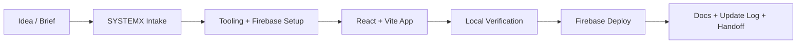
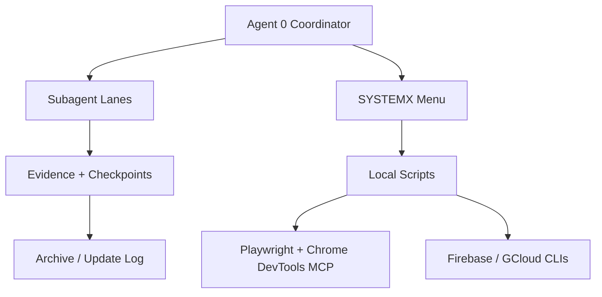

# WebAppX — SYSTEMX Forever WebApp

**Unified public template 3.4.0 · managed dotSYSTEMX 1.9.0-alpha.6**

A reusable React, TypeScript, Vite, Tailwind and Firebase webapp with the full
managed SYSTEMX operating layer, a guarded local LAN builder, production and
brand kits, setup workflows, and browser/agent tooling. WebAppX is maintained
solely by [WayneTechLab](https://github.com/WayneTechLab), with a fresh repository
history based on the reviewed SFWA-WTL-TEMPLATE release. See the
[WebAppX provenance and ownership record](docs/WEBAPPX.md).

```bash
npm run doctor         # read-only local prerequisite report; no dependencies needed
npm ci
npm run browser:install # explicit first-time Chromium download
npm run systemx:status
npm run systemx:validate
npm run ci:all          # reusable-template release checks; seeds must remain blank
bash .SYSTEMX/WSG-MENU.sh
# Start the local app, LAN dashboard and Firebase emulator session:
npm run dev:systemx
```

The launcher selects available loopback ports and tracks its own processes.
To reopen the same browser saves, choose an origin explicitly with
`npm run dev:systemx -- --host 127.0.0.1 --port 5185`. An occupied fixed app
port fails without falling back to another address. Use
`npm run systemx:session:status` to read component readiness and
`npm run systemx:session:stop` to stop the recorded owned session.
For a Windows combined session, stop refuses and preserves state; use **Ctrl+C
in its owning terminal** and inspect the children/listeners after shutdown.
Firebase configuration belongs to the adopted project.

SYSTEMX includes project and child-workspace management, bounded Agent 0
coordination, Agent X event records, optional Agent Y CLI handoffs, Agent Z
repeatable reviews, task/dependency tracking, context and memory, release
management, and verified upstream imports. The new access matrix and project map
are blank records for adopted projects. The registry seeds only Agent 0;
importing the release does not activate roles or start a provider. Agent Y needs
a selected installed CLI, a bounded task and an explicit branch/PR policy.
The shipped project/task/memory records remain blank reusable seeds.

Read the [getting-started guide](docs/GETTING-STARTED.md),
[command reference](docs/COMMANDS.md), [template maintenance guide](docs/TEMPLATE-MAINTENANCE.md),
and the [integration guide](docs/SYSTEMX-INTEGRATION.md),
[adoption example](docs/examples/private-template-adoption.md),
[release provenance and feature map](docs/UNIFIED-TEMPLATE.md),
[3.4.0 validation receipt](docs/VALIDATION-3.4.0.md), and
[entry point](.SYSTEMX/START-HERE.md). Inspect ownership with
`npm run systemx:provenance`, then preview upstream updates with
`npm run systemx:upstream:check -- --limit 25`. The bounded review reports the
exact source/public-main observation, preserved host paths and bootstrap
conflicts; pagination retains complete blocking totals. A preview applies no
changes. Read [upstream review](docs/SYSTEMX-UPSTREAM-REVIEW.md) before applying
reviewed updates with
`npm run systemx:upstream:import`. The upstream distribution is immutable and pinned.
The importer previews recognized stock bootstrap replacements, then backs up
and refreshes them before selecting changed defaults. Original snapshots and
adopted downstream records remain preserved. The schema 2 distribution manifest
hashes media and unknown files byte for byte.

Use `npm run systemx -- tools-guide` for the selected command guide. A separately
installed current SYSTEMX CLI can route child records explicitly with
`systemx projects --target "/path/to/workspace" -- context --project NAME --agent agent.0`.
Core PowerShell launchers are included; native Windows Agent Y `run --apply`
remains unavailable pending verified descendant-process termination. Local
macOS checks do not establish Windows runtime or deployed Firebase acceptance.

## Developer readiness and automated portal smoke

Use **`npm run doctor`** before setup for a dependency-free, read-only report of
installed Node.js, npm, Git and Python versions. **`npm run --silent doctor -- --json`**
returns machine-readable results. The policy requires **Node.js 24.0.0 or newer**
and **Python 3.12.0 or newer**; npm and Git must be present with parseable versions.
If npm is missing, run **`node scripts/developer-prerequisites.mjs`** directly
to diagnose the installed tools. The quiet npm JSON command omits npm's headers.
The report does not install tools, configure services or establish platform
runtime acceptance.

The root app and reusable starter pin **Node 24.22.0** in `.nvmrc` and
`.node-version`, declare the supported minimum **Node >=24.0.0**, and record
**npm 11.11.0** as the package manager. Select the checked-in runtime pin with
your installed version manager, then use `npm ci`. **`npm run development:check`**
compares root/starter runtime declarations, public client environment-variable
coverage and ignored local environment-file rules. It reads checked-in source
and examples without opening private environment files or returning secret values.

The [dependency installation guide](docs/DEPENDENCY-INSTALLATION.md) explains
runtime selection, locked installs and the optional Functions adapter's separate
Node 22 environment. Installing packages and downloading Chromium have their own
effects; a successful installation does not establish passing application checks.

### Start only the native account-free portals

```bash
npm run dev:mock
# Optional stable origin for saved samples:
npm run dev:mock -- --port 5185
```

The launcher prints its `/portals` URL on `127.0.0.1`, uses a free port by
default and strictly binds an explicitly chosen port. An occupied port produces
an error and preserves the existing listener. Its child ignores `.env` files
and inherited provider/client configuration, with Firebase, emulators, LAN and
provider integrations disabled. Ctrl+C stops only this launcher's resources.
Use the same browser origin to retain saves across runs; changing the port
selects separate browser storage. When Firebase is unset, the app's visible
**Account-free mode** notice links to the portals and the optional sign-in setup.

After `npm ci`, run **`npm run browser:install`** once to install the Chromium
browser for the exact pinned **Playwright 1.64.1** dependency. Then run
**`npm run browser:smoke`**. It starts its own Vite server on an available
`127.0.0.1` port and uses a fresh Chromium context, leaving existing app listeners
and browser saves intact. The smoke checks the named synthetic seed pack/hash
and expected dashboard totals, makes a domain change through each HR/CMS/CRM
interface, reloads and compares complete exported states. No provider account,
credentials or Firebase emulators are required.

The smoke prints the location of its temporary report, screenshots and trace,
and cleans up only the browser/server it owns. It never downloads a browser
automatically; a missing installation fails with the explicit install command.
`ci:all` includes the prerequisite regressions, deterministic seed checks and
browser smoke. Read [Getting Started](docs/GETTING-STARTED.md#developer-check-and-browser-smoke),
[Testing & QA](wiki/Testing-and-QA.md#automated-developer-and-portal-smoke-checks)
and the [developer/browser QA receipt](docs/DEVELOPER-BROWSER-QA-2026-10-14.md)
for the checked revision and evidence. These local checks do not verify Windows
runtime, live Firebase/Gusto integration or production deployment.

**Verified locally — 2026-10-14:** all 18 doctor regressions and 16 seed/runner
regressions passed. The Mac prerequisite report passed with Node 25.8.1, npm
11.11.0, Git 2.54.0 and Python 3.14.5. All seven authored browser checks passed:
fresh named baseline, HR goal/CMS draft/CRM lead changes with reload and complete
payload comparisons, exact saves without account cookies, a second clean context
and request/error isolation. Both owned browser and Vite cleanup checks passed;
only the expected unconfigured-Firebase warning appeared. Independent source
review had no unresolved findings. Full `ci:all`, Hosting preflight and SYSTEMX
drift checks passed, including the integrated seven-gate browser run with an
isolated optimizer cache. The receipt records all suite counts and five
filesystem-specific skips. No production deployment ran.

### Keyboard onboarding and restore/Undo checks

Run **`npm run browser:keyboard`** after the same explicit Chromium installation
to exercise **WX-0653** onboarding and **WX-0654** selective restore/Undo. Use
**`npm run browser:keyboard:test`** for the focused driver guards. The keyboard
journeys reuse the isolated loopback server and clean-context runner; the earlier
`browser:smoke` command remains available.

The driver reaches controls with real **Tab** traversal, activates them with
**Enter/Space**, types through keyboard input and checks the focused element's
visible outline/ring. App-managed transitions advance focus through onboarding's
required steps and onto its completion status. Restore and Undo previews focus
their headings; cancellation/completion returns to the opening control, with a
history-heading fallback when that control is unavailable. These are ordinary
page regions with normal Tab navigation.

Initial navigation/reload and handing a local file to a keyboard-opened native
file chooser are explicit test-harness boundaries. The checks do not automate
the operating system's chooser keys or establish whole-site, screen-reader or
WCAG acceptance. See the [keyboard guide](docs/TEMPLATE-PORTALS.md#keyboard-onboarding-and-recovery),
[testing guide](wiki/Testing-and-QA.md#keyboard-onboarding-and-selective-recovery)
and [keyboard QA receipt](docs/KEYBOARD-PORTALS-QA-2026-10-15.md) for exact scope
and current outcomes.

**Keyboard verification — 2026-10-15:** all **nine browser checks** passed
(three onboarding, six restore/Undo), recording **110 onboarding and 266 recovery
focus observations**. The **11 keyboard driver guards** and **16 existing
seed/runner guards** passed. Required-field rejection preserved saves;
`MOCK-ONBOARDING-0001` survived refresh with complete expected records. Selective
restore/cancel/Undo preserved unselected CRM and exact payloads/history, including
focus return to the original Undo button and the history heading when retention
removed it. Both owned resources closed; only the expected Firebase warning
appeared. Independent review had no unresolved findings. Full `ci:all` and
Hosting preflight passed, including seven smoke and nine keyboard browser
checks; the keyboard receipt records the suite counts and scope.

## Local session, portal state and evidence contracts

The integrated launcher prints the exact **Mock save origin** and **Portal
directory** URL. A save belongs to the same scheme, hostname, port and browser
profile. `localhost` and `127.0.0.1`, different ports, and different profiles
have separate browser storage. Use `--host 127.0.0.1 --port 5185` to retain that
address, or `--fixed-origin` to pin the default `http://127.0.0.1:5173`.
The default without origin overrides selects free ports. Fixed origin requests
fail on a busy app port; Vite also binds strictly if a listener appears during startup.

Readiness is reported separately for **Vite app, LAN, Auth, Firestore and Storage**.
A usable app can coexist with failed emulators. HTTP readiness responses are
checked for Vite, LAN, Auth and Firestore; Storage reports only a reachable
listener. Read `npm run systemx:session:status` for each component's recorded
`starting`, `ready` or `failed` result and reason. Those observations do not
establish emulator workflow or provider acceptance.

**`npm run systemx:session:restart:preview`** reads process ownership and current
listeners and prints a proposed launch using the recorded origin and ports.
It changes no processes, listeners or runtime files. A `ready-for-review` result
is a snapshot: availability and ownership must be rechecked before an actual
restart. Read the [session guide](docs/GETTING-STARTED.md#start-the-integrated-local-workspace)
for the output and refusal cases.

The [portal state contract](docs/PORTAL-STATE-CONTRACT.md) lists retained records,
temporary forms and navigation/reset/restore behavior for each native portal.
The [capability matrix](docs/PORTAL-CAPABILITIES.md) describes the synthetic role
projections and domain checks. Complete JSON demo backups include private mock
drafts and records across preview roles; selecting a role does not filter a
backup. Read these contracts before using shared browser profiles or moving files.
Run **`npm run browser:state-contract`** for the isolated browser journey covering
the documented record, temporary-input and recovery boundaries.

The [backlog evidence index](docs/BACKLOG-EVIDENCE.md) attaches scoped reviews and
original evidence to catalog IDs, including unfinished items. Use
`npm run backlog:evidence -- --id WX-0717 --category browser` and
`npm run backlog:evidence:check`. A review attachment preserves its original
date, revision and limitations; it does not change completion state or satisfy
unfinished dependencies. The [session/contracts QA receipt](docs/SESSION-CONTRACTS-QA-2026-10-15.md)
records the integrated checks and their acceptance boundaries.

**Historical accepted checkpoint — 2026-10-15:** nine additional items were complete:
**WX-0007–WX-0010, WX-0060, WX-0501, WX-0601, WX-0805 and WX-0854**.
At that checkpoint the catalog reached **33 done / 967 remaining**. All **38 CI stages** and
Hosting preflight passed, including **42 session tests, 15 evidence-index tests**
and **36 browser checks** across smoke, keyboard, foundation and state-contract
suites. All owned browser/server resources closed. The full 1,000-item goal
remains active; the QA receipt records fixes and platform/provider boundaries.

## Operational contracts and lifecycle checks

Use **`npm run repository:identity`** before an authorized publication review
for origin/push identity, branch, direct GitHub main and separate worktree/index
observations. **`npm run environment:check`** validates tracked configuration
examples and classifications through a fixed six-file allowlist, without reading
private environment files or shell values. Neither report activates a service.

**`npm run browser:payroll`** exercises two employees' elections and approved
hours through one simulated payroll, then reconciles their scoped statements.
**`npm run browser:lifecycles`** checks CMS review/publication and later draft
separation, plus linked CRM conversion/follow-up and explicit replay guards.
Read the [QA coverage map](docs/QA-COVERAGE-MAP.md),
[command effects table](docs/COMMAND-SAFETY.md),
[health vocabulary](docs/MONITORING.md),
[security assumptions](docs/SECURITY-ASSUMPTIONS.md),
[configuration proposal](docs/ENVIRONMENT-CONFIGURATION.md) and
[repository receipt guide](docs/REPOSITORY-IDENTITY.md).
The [operational-foundations receipt](docs/OPERATIONAL-FOUNDATIONS-QA-2026-10-15.md)
records execution results, fixes and acceptance boundaries for this wave.

**Historical operational checkpoint — 2026-10-15:** nine more original criteria
were verified, bringing the checklist then to **42 done / 958 remaining**.
At that checkpoint all **43 CI stages**, **56 browser checks** and **Hosting preflight passed**;
each browser suite confirmed owned cleanup. The final focused repository suite
passed 26 tests after the symlink entry-point fix; configuration validation
passed 22 tests. Provider and operator requirements retain their stated evidence
gates, and the complete 1,000-item goal remains active.

## Backlog adoption and recorded work

Agent 0 accepted **WX-0851, WX-0852, WX-0855, WX-0856, WX-0857 and WX-0858**
against their original local criteria. The current catalog has **48 done /
952 remaining**, with **125 P1, 670 P2 and 157 P3** remaining. Remaining gates
are **784 local, 128 operator and 40 provider**. The complete 1,000-item goal
remains active, and source completion does not transfer acceptance to an adopted app.

| Capability | Entry point and boundary |
| --- | --- |
| Reviewed TODO intake — WX-0851/WX-0855 | [`backlog:adopt`](docs/BACKLOG-ADOPTION.md) previews 1–40 selected proposals for an explicit adopted app/root or registered child. Apply records reviewed TODOs with valid owners/dependencies; independent credential, authorization and local prerequisite dimensions default to unknown. Intake grants no execution authority. |
| Source impact — WX-0852 | [`backlog:impact`](docs/BACKLOG-REBASELINE.md) compares two explicit local committed revisions and requests review for affected scopes without changing catalog or canonical task state. |
| Recorded work — WX-0856 | [LAN work status](docs/WORK-STATUS.md) separates reusable work seeds, roadmap counts and an explicitly selected root/child's recorded work. Missing or invalid data is unavailable; valid empty work means no work recorded. Roles do not observe running workers. |
| Ownership inventory — WX-0857 | [`systemx:provenance`](docs/SYSTEMX-PROVENANCE.md) separates host ownership, retained byte/manifest equality and immutable release content. A blank stock match grants no overwrite authority. |
| Bounded upstream review — WX-0858 | [`systemx:upstream:check`](docs/SYSTEMX-UPSTREAM-REVIEW.md) binds the exact source/current public-main observation and reports preserved host-only paths and bootstrap conflicts without applying an import. |

Focused verification passed **95 SYSTEMX integration tests** (including 23
adoption, 23 provenance and 13 upstream-review cases), **19 impact tests**,
**37 work-status tests**, **six owned LAN browser checks** and **13 CI-plan
tests**. The current CI plan contains **46 stages**; planning does not execute
them.

**Integrated verification passed: all 46 CI stages, 62 browser checks and Hosting preflight.**
**Generated catalog/plan, link and preservation checks passed.** GitHub
publication uses final repository-identity and native-wiki parity checks. Read the
[adoption/status/review QA receipt](docs/SYSTEMX-ADOPTION-QA-2026-10-15.md)
for the examined source, fixes, preservation checks and acceptance boundaries.

## Current SYSTEMX features

WebAppX 3.4.0 includes the pinned dotSYSTEMX 1.9.0-alpha.6 distribution. Its
shared tools run from the verified selected release; your app's records live in
the outer `.SYSTEMX` or an explicitly selected child `.SYSTEMXP`.

| Capability | Entry point and use |
| --- | --- |
| Agent 0 coordination | Context, plan, canonical tasks, ownership and acceptance |
| Agent X events | Record observed times, revisions and original evidence |
| Agent Y CLI handoffs | Give one scoped task to an installed Codex/Copilot CLI, with a separate worktree and optional draft PR |
| Agent Z reviews | Apply the versioned evidence questions before acceptance |
| Access matrix and project map | Blank `GLOBAL/ACCESS-MATRIX.md` and `PLAN/MAP.md` for reviewed access and source boundaries |
| Child projects | Explicit `.SYSTEMXP` selection through `projects ... --project NAME` |
| CLI/tools guide | `npm run systemx -- tools-guide` |
| Verified manual updates | Preview/import exact public source, back up recognized stock launchers, retain immutable snapshots and adopted records |
| Adoption and work inspection | Reviewed TODO intake, committed source impact, explicit recorded-work scopes, ownership inventory and bounded upstream review |
| HR and Gusto | Portable `.SYSTEMX/GUSTO/` contracts, complete native synthetic journeys and selected pinned SDK workflow previews |

## Roadmap and execution of all 1,000 items

The [WebAppX roadmap](docs/WEBAPPX-ROADMAP.md) links **exactly 1,000 improvement
items across 20 areas**, covering HR, CMS, CRM, local recovery, security,
Firebase adoption, design, quality, operations, SYSTEMX and integrations.
Each has a stable `WX-0001`–`WX-1000` ID, priority, phase, specific acceptance
check, existing source pointer, acceptance gate and dependencies.
Verified completions include their evidence in the canonical catalog; unfinished
items remain open work. The catalog contains exactly **1,000 records**. Read
`npm run backlog:summary` or the generated execution plan for current completion,
priority and remaining-gate counts. Completion
evidence and accepted dependencies remain attached to each completed ID.

- [Read the complete list](docs/backlog/WEBAPPX-1000-TODO.md)
- [Execution plan for the full catalog](docs/WEBAPPX-EXECUTION-PLAN.md)
- [Canonical JSON](docs/backlog/webappx-1000-todo.json) · [CSV](docs/backlog/webappx-1000-todo.csv)
- [SYSTEMX planning pointer](.SYSTEMX/WEBAPPX-ROADMAP.md)

Run `npm run backlog:summary`, or query one area with
`npm run backlog -- --area mock-recovery --priority P1 --limit 10`.
`npm run backlog:check` validates the exact count, IDs, sources, dependencies and
generated views as part of `ci:all`. The catalog retains its stable 1,000-item
planning scope; delivered items are tracked in the roadmap with their evidence.
It does not represent 1,000 implemented features or active agent jobs. The
reusable SYSTEMX records stay blank; optional provider/operator work requires
its own reviewed adoption scope.

The owner authorized completing the entire catalog on **2026-10-15**. The active
goal covers all 1,000 original acceptance criteria and requires reviewed
implementation and evidence for each item. The generated execution plan partitions every stable
ID into workstreams and waves and reports dependency-ready candidates. Run
**`npm run backlog:plan`**, **`npm run backlog:ready`**, or
**`npm run backlog:graph -- --id WX-0654 --id WX-0551`** to inspect scope and
dependencies without starting workers or changing completion state. Provider and
operator criteria retain their specific proof and activation boundaries.
The goal remains active until every item is accepted; the host execution plan
records this intent while reusable SYSTEMX task/context/plan/memory seeds stay blank.

### Foundation workflow

The portal directory now shows registry-defined descriptions, workflows and roles,
plus **Ready / Saved / Recovered / Unavailable** browser-save summaries for each
workspace. Shared mock notices and breadcrumbs explain local fictional records
and provide return paths. Trailing-slash deep links retain their query/hash;
unsupported portal pages offer recovery links without changing saved records.
Use **`npm run browser:foundation`** for the authored shell, route and save-state
journey alongside the existing smoke and keyboard commands.

**`npm run ci:plan`** reads the actual `ci:all` runner and package declarations
to report stage order, dependent workspaces and reviewed mutation behavior.
It executes no gates and labels unreviewed commands as unknown. Use the
[foundation QA receipt](docs/EXECUTION-FOUNDATION-QA-2026-10-15.md) for this wave's
actual checks, acceptance IDs and publication evidence.

**Foundation verification — 2026-10-15:** 15 development-contract tests,
14 mock-launcher tests, eight planner tests, 14 catalog tests and 121 portal
model tests passed. The CI report passed 13 tests and described the then-current 34 required
stages with no unknown classifications. All nine foundation browser checks and
the existing nine keyboard checks passed, including unset-Firebase guidance,
normalized routes, keyboard breadcrumbs, unsaved-form preservation and synthetic
storage recovery/unavailability. Owned cleanup succeeded; only the expected
unset-Firebase warning appeared. Full `ci:all`, Hosting preflight and final
host drift/plan/checklist checks passed; the receipt retains the diagnosed
failures, corrections and final suite results. The full goal remains active.
At that foundation checkpoint, Agent 0 accepted 17 additional IDs, bringing the total to 24. The full goal remains
active; the receipt holds final integrated CI, preflight and publication results.

### First P1 portal improvements

**WX-0051 — shared portal registry:** [one typed registry](src/portals/registry.ts)
owns HR, CMS and CRM module identities, labels, demo routes and descriptions.
The shared directory, navigation and cross-links use that metadata; backup and
restore validation use the same module identities. Registry metadata does not
grant authentication or copy records between portals.

**WX-0451 — restore storage-budget preview:** before confirming a combined
selective restore or Undo, inspect each selected workspace's serialized character count
against its 2,000,000-character limit, the new recovery point and projected
history after retention pruning. History keeps at most five points within
2,000,000 characters. The preview follows the current selection, saved domain
state and history; it does not save a restore point or replace records.
An empty selection prompts for a portal, while invalid data, rejected history
or an oversized budget blocks confirmation. Undo's portal scope remains fixed to
the chosen point.

These counts describe app limits, not available browser quota. The browser may
refuse a smaller write; confirmation revalidates and must successfully save the
recovery point before replacing workspaces. Read the
[portal guide](docs/TEMPLATE-PORTALS.md#restore-storage-budget-preview) and
[P1 verification receipt](docs/PORTAL-REGISTRY-BUDGET-QA-2026-10-14.md) for the
checked behavior and evidence boundaries. Version remains **3.4.0**, with
deployment count **0**.

**Local browser verification — 2026-10-14:** registry navigation and cross-links,
HR-only/CMS+CRM/all-three restores, refresh and Undo passed. Exported payloads
matched their expected snapshots, including cancellation and unselected-portal
preservation. History matched each preview; the sixth restore retained five
points and pruned one. A near-limit current CMS workspace correctly blocked a
small incoming bundle because its automatic recovery point exceeded the history
budget. Cancellation preserved all workspace payloads. These are local mock
checks; the receipt records exact counts and failure coverage.

Full `ci:all`, Hosting preflight and SYSTEMX drift checks passed for this update,
including 114 portal tests, 116 HR tests and 13 catalog tests. The
[QA receipt](docs/PORTAL-REGISTRY-BUDGET-QA-2026-10-14.md) records the remaining
suite counts and five filesystem-specific skips. No production deployment ran.

The reviewed 2026-10-14 SYSTEMX refresh observed public main
`3fb59429c878268f1081ca255a1f32fafc5dcfba`. Its `.SYSTEMX` tree is identical to
the original **1.9.0-alpha.6** import, so the selected version and receipt stay
intact. Documentation-only upstream commits can now pass the update check when
their complete SYSTEMX source trees and manifest fingerprints match. Different
same-version source trees remain rejected. See the
[refresh/roadmap receipt](docs/SYSTEMX-ROADMAP-QA-2026-10-14.md).

## Gusto, employees and management

The new [Gusto setup guide](docs/GUSTO-SETUP.md) and
[HR wiki guide](https://github.com/WayneTechLab/WebAppX/wiki/Gusto-HR-and-Employee-Management)
standardize management, employee, manager and contractor pages. The portable
package lives under [`.SYSTEMX/GUSTO/`](.SYSTEMX/GUSTO/README.md), with subfolders
for documentation, schemas, SDK inventory, synthetic fixtures, webhook contracts
and connector examples. React and Firebase runtime adapters remain host code.

```bash
npm ci
npm run hr:test
npm run dev
# Open Vite's printed URL at /hr/demo
# Genuine local SDK directory/onboarding/payroll previews: /hr/demo/sdk
```

The account-free HR workspace supports four linked synthetic journeys:

| Workflow | Local preview journey |
| --- | --- |
| Employee onboarding | Review the fictional profile/job, complete the checklist, then review the summary and confirm simulated completion. |
| Time tracking | Enter and submit a timesheet; the fixture's scoped manager approves it before payroll can consume its hours. |
| Payroll | Prepare approved hours, calculate fictional totals, review the run and simulate submission with a visible mock receipt. |
| Benefits | In the employee self preview, elect sample enrollment or waiver, review it and confirm the fictional election. |

Use the [step-by-step account-free guide](docs/GUSTO-SETUP.md) for the role and
route sequence. Native HR saves completed domain actions in this browser’s local
storage, so onboarding, benefits, time and payroll survive refresh at the same
origin. **Reset sample changes** clears only HR’s saved snapshot and restores its
fixtures; no Gusto account, provider request or cloud service is needed. Mock
payroll totals and receipts do not establish payroll accuracy or payment execution.

**Earlier browser verification — 2026-10-14:** the linked native mock was checked through
onboarding, approved hours, retirement enrollment, payroll submission and a
separate employee's waiver. A changed work email now invalidates pending
onboarding review; sample timers retain their starting employee, role and date,
and cancel on identity changes or Reset. Payroll keeps prepared inputs until a
new preparation and excludes hours already linked to a receipt. At that checkpoint,
the HR suite passed **41 tests** (16 native, 11 SDK-client mock and 14 backend). Read the
[dated browser QA receipt](docs/GUSTO-BROWSER-QA-2026-10-14.md) for exact values,
receipts and boundaries. The October 13 release receipt's 39 tests remain
historical; that verification kept version **3.4.0** and did not retest the
separate SDK UI or establish provider acceptance.

| Native mock result | Fictional gross | Illustrative withholding | Sample benefit | Simulated net |
| --- | --- | --- | --- | --- |
| Jordan — confirmed retirement enrollment | $240 | $48 | $25 | $167 |
| Avery — confirmed health waiver | $240 | $48 | $0 | $192 |

The native portal extension also provides these account-free previews:

| Area | Native mock workflow |
| --- | --- |
| Time off | Request, approve, reject or cancel vacation/sick leave, with fixed sample balances, weekday hours and overlap guards. |
| People assignments | Complete tasks and training, acknowledge policies and eligible documents, acknowledge assigned assets and request/confirm their return within role scope. |
| People activity | Follow scoped operation receipts and status changes in the current session. |
| Dashboards and reports | Derive workforce, onboarding, time, benefit, absence and submitted-payroll views from the selected role's native state. |
| Employee pay history | Read own simulated statements from submitted native payroll receipts; per-employee deductions are capped to that employee's available sample pay and reconcile to run totals. |
| HR help desk | Employee creates a fictional equipment, app-access or general HR request; a scoped manager or HR assigns, starts, resolves and can reopen it. |
| Recruiting | Owner/HR publishes a draft sample job and moves fictional candidates through applied, screening, interview, offer and mock hire into native onboarding. |
| Performance | Own goal progress and self-review, assigned manager feedback/publication, then employee acknowledgment, with private draft projections. |
| Identified feedback | Owner/HR drafts and publishes a survey; assigned employees save/submit their own answers; submitted identified results feed scoped counts before closure. |

The added request/activity routes belong to WebAppX; the portable **64-page**
SYSTEMX contract remains unchanged. The earlier browser receipt above retains
its original checkpoint. See the
[native portal walkthrough](docs/GUSTO-SETUP.md#native-people-operations-and-service-desk)
and [HR portal guide](docs/HR-PORTAL.md) for the synthetic policy, actor scopes
and remaining production work.

The [talent workflow guide](docs/HR-PORTAL.md#recruiting-performance-and-identified-feedback)
describes the new module APIs and role gates. A mock hire starts in onboarding
with compensation unconfigured. Performance authorship stays with the employee
and assigned manager. Survey results are **identified**, with submitted names
and answers visible to owner/HR and the read-only auditor. Saved drafts remain
with their author; employee views exclude other people's answers. The
[talent/CMS/CRM QA record](docs/HR-TALENT-QA-2026-10-14.md) records that earlier wave's
browser acceptance and test totals separately from the earlier portal checkpoint.

The earlier talent checkpoint passed **129 model tests**: **109 HR**, **10 CMS**
and **10 CRM**. These historical checks remain separate from the
[current persistence verification](docs/PORTAL-PERSISTENCE-QA-2026-10-14.md) and
from real provider or production acceptance.

| Selected talent/CMS browser check — 2026-10-14 | Observed native result |
| --- | --- |
| Recruiting and new-hire pay | Casey completed native onboarding, submitted eight October 15 hours and received Morgan's approval. `MOCK-PAYROLL-0003` and own pay history matched $240 gross/$48 illustrative withholding/$0 benefit/$192 net. |
| Performance | Private self/manager drafts, publication and employee acknowledgment followed their role gates. |
| Identified survey | Two submitted ratings, 5 and 3, produced 2/2 responses and mean 4. Private drafts contributed no results; closure produced `MOCK-SURVEY-0007`. |
| CMS | Returned revision 2 for changes; separately approved/published revision 3 (`MOCK-CMS-0007`). Editing revision 4 retained public revision 3 until new approval/publication; retirement removed the article. Viewer mutation controls were absent; duplicate slugs were refused. |
| CRM | Qualified/converted a lead once, advanced its $1,500 opportunity to won and completed follow-ups. Riley's dashboard showed $2,500 open/$1,500 won/0 follow-ups; foreign-owner records and auditor mutation controls were absent. |
| Portal preservation and Reset | A CMS draft, HR's four people and CRM's $1,500 won value survived shared navigation. Reset CMS removed only its draft; HR and CRM values stayed intact. |

**Earlier portal wave checks:** at that checkpoint, `npm run hr:test` passed **70 tests**: 17 native
workflow, 9 people operations, 7 insights, 7 linked operations, 5 service desk,
11 SDK-client mock and 14 backend boundary checks. After a full reload, the
selected native portal paths also passed browser verification:

| Earlier portal check — 2026-10-14 | Observed native mock result |
| --- | --- |
| Linked assignments and assets | Avery's policy updated her task/checklist; Jordan's training updated his task without completing onboarding. Employee asset return required Morgan's confirmation. |
| Leave | October 19–20 recorded 16 weekday hours; overlap was refused. Scoped rejection/approval and employee cancellation restored Avery's 40-hour vacation balance. |
| Service desk | Avery and Morgan completed the seven-action create/assign/start/resolve/reopen cycle; Jordan saw no requests. |
| Payroll and pay history | `MOCK-PAYROLL-0003` and Avery's own statement matched: $240 gross, $48 illustrative withholding, $25 sample benefit and $167 net. Jordan saw no statement. |
| Reports and auditor | Owner totals reconciled to the consumed time and payroll receipt; auditor reports/history exposed no amounts or mutation controls. |

Read the [portal QA record](docs/HR-PORTAL-QA-2026-10-14.md) for the exact scope.
The earlier 41-test browser receipt remains historical. Native and SDK state
remain separate; this wave did not rerun the SDK UI or call a provider.

Employee search/profile records and contractor previews remain available. Page
specifications identify additional modules whose adapters still need adoption.
Connected portals remain guarded until an adopted app supplies trusted HR
memberships and its authorized backend integration.

The template pins **Gusto React SDK 0.56.6 / API 2026-06-15**. `/hr/demo/sdk`
mounts the genuine employee directory, admin onboarding data flow and payroll
execution flow against isolated development-only mock sessions. Onboarding
includes explicit simulated form/new-hire review and status readback; payroll
uses local prepare/calculate/poll/review/synthetic-submit transitions through
the genuine submitted summary. Only the
selected mock operations can mutate fictional fixtures; credentials, unknown
endpoints and real provider transport remain unavailable. I-9, legal signatures,
tax filing and money movement are outside these samples. Benefits and time use
native interfaces because this SDK version has no corresponding UI flows.
Native and SDK sample state are separate, and selected component coverage does
not establish full SDK or provider acceptance.
The optional [Firebase module](docs/GUSTO-FIREBASE.md) includes organization
data contracts, restricted rules, callable foundations and webhook tests, with
live provider transport disabled by default.

**There is no documented shared/public Gusto test key.** A real Demo integration
requires a Developer Portal account and application-specific credentials.
Gusto's [hosted Flows showcase](https://docs.gusto.com/embedded-payroll/docs/try-it-now)
can be viewed without API keys. Use the local mock to build the template before
obtaining a sandbox connection; see [Gusto's setup requirements](https://docs.gusto.com/embedded-payroll/docs/getting-started).

Gusto owns payroll, tax/bank and provider document workflows. The app owns
tenant membership, source mappings and native HR capabilities such as recruiting,
policies, assets, access, training and performance. The feature/page contracts
distinguish specifications, working mock controls and live-gated provider actions.
The full repository supplies this HR extension; the standalone starter folder
remains a smaller app scaffold.

## Account-free business portals

Use the **Template Portals** entry to move between the native workspaces:

| Route | Runtime preview |
| --- | --- |
| `/portals` | HR, CMS and CRM directory |
| `/hr/demo` | People operations, talent workflows and simulated employee pay |
| `/cms/demo` | Plain-text draft → separate revision review → approval → simulated publication/retirement |
| `/crm/demo` | Owned companies/contacts, lead qualification/conversion, opportunity stages, follow-up tasks and pipeline totals |

Each module saves its fictional domain records in a separate, versioned
`localStorage` snapshot. Refreshing, leaving the demo area and returning, or
visiting `/hr/demo/sdk` preserves saved native HR, CMS and CRM records in the
same browser and origin. A module’s **Reset** clears only that module’s saved
snapshot and restores its fixtures. SDK sample state stays separate. Preview
roles do not grant Firebase claims, and no HR records or personal data are
automatically shared with CMS/CRM.

Storage status is visible in each workspace. Blocked or full browser storage
falls back to memory; malformed or unsupported snapshots start fresh fixtures
with a visible notice. Unsaved form fields and running timers are excluded from
workspace saves and exports; navigation can clear them before refresh. Private browsing, clearing site data, or changing hostname
or port can remove or hide saved samples. Multiple tabs do not merge live
changes: the last successful write wins. Use fictional data only; preview roles
are not browser security, and anyone with access to this browser can inspect
its saved records. See the [persistence QA receipt](docs/PORTAL-PERSISTENCE-QA-2026-10-14.md)
for the current checked paths.

The CMS viewer is a read-only editorial identity; only the published-sample
projection excludes draft content. A simulated CMS publication does not update
the actual website. CRM won amounts are sample pipeline values, not revenue or
payments. See [Template Portals](wiki/Template-Portals.md) and the
[portal architecture and adoption guide](docs/TEMPLATE-PORTALS.md) for the
separate role and data boundaries. Earlier talent test/browser results are
recorded in the [talent and business-portal QA receipt](docs/HR-TALENT-QA-2026-10-14.md),
separately from the earlier HR receipts.

### Back up or move a mock workspace

Each native workspace has **Export workspace** and **Import workspace** controls.
Use a separate JSON file for one portal, or use **Export all workspaces** on
`/portals` to download HR, CMS and CRM together.

1. Save the domain actions you want to keep, then choose **Export workspace** in
   HR, CMS or CRM. The browser downloads that module’s validated current snapshot.
2. Copy the file to your other browser or computer and open the matching portal.
   Choose **Import workspace** and select the local JSON file. Nothing is uploaded.
3. Inspect the module, export time and file in the preview. Choose **Replace HR
   workspace**, **Replace CMS workspace** or **Replace CRM workspace** to confirm,
   or **Cancel import** to keep the current workspace. Import replaces the entire matching
   module; it does not merge records. Export the destination first to keep a copy.
4. The imported workspace saves to that browser’s own storage. Refresh to check
   it restored; the other two portals keep their separate records.

The importer checks the file size, backup format/version, module and full nested
record schema before replacing anything. Invalid, incompatible or wrong-module
files preserve existing records. If the browser cannot save the replacement,
import keeps the prior workspace and shows an error. Existing local-storage
snapshots retain their format; use **Export workspace** to create a portable file.

Files are plain-text JSON containing the whole fictional workspace, including
private review/survey drafts, feedback and mock receipts, regardless of the
currently selected preview role. Unsaved form edits, running timers, most UI
selections and the independent SDK sample are excluded; native HR retains its
saved role/employee choice. A file is not encrypted, authenticated provider data
or proof that payroll/publication occurred. Use fictional information only.
The [per-portal backup QA receipt](docs/PORTAL-BACKUP-QA-2026-10-14.md) records
that feature’s earlier browser and automated checks.

### Back up all three and restore selected workspaces

Open `/portals` and choose **Export all workspaces**. One JSON file contains the
complete current HR, CMS and CRM domain snapshots; an untouched portal contributes
its initial sample even if it has no saved browser snapshot yet.

1. Move the combined file to the destination browser/computer and open `/portals`.
   Export the destination first if its current records need a backup.
2. Choose **Import combined backup** and select the local JSON file. The whole
   file, including all three module schemas, must validate before the preview opens.
3. Review its file, export time and three record summaries. All HR/CMS/CRM boxes
   start unchecked. Select one, two or all three complete workspaces.
4. Choose **Restore selected workspaces**, or **Cancel combined restore** to keep the destination.
   Selected portals are replaced in full and saved for refresh; unselected portals
   keep their current records and browser saves. No records are merged.

Restoring resets selected portals’ unsaved forms and active timers. The selected
snapshots are revalidated and all their browser saves are attempted before their
in-memory workspaces change. On a storage-write failure, the app attempts to
restore the selected keys’ previous bytes and keeps the prior in-memory records.
If that rollback also fails, an explicit warning reports potentially partial
browser storage: export current in-memory workspaces before refreshing, allow
storage, and retry the restore or Reset the affected portals. `localStorage`
provides no atomic transaction across three keys. Unselected keys are never written.

Combined files and individual portal files have separate formats and matching
import controls. Both are plain-text fictional records with private drafts and
mock receipts, and exclude unsaved fields, running timers, authentication data
and the independent SDK session. They require no account, upload or provider.
Read the [combined backup guide](docs/TEMPLATE-PORTALS.md#combined-backup-and-selective-restore)
and [combined QA receipt](docs/COMBINED-BACKUP-QA-2026-10-14.md) for the feature’s
verification scope. Earlier per-portal results follow separately.

### Automatic restore points and Undo

Before **Restore selected workspaces** overwrites anything, WebAppX saves a
browser-local restore point of only the selected portals’ current domain states.
If that point cannot be validated or saved, the restore is refused. On `/portals`,
**Restore points & Undo** survives refresh and lists each point’s time and affected
portals, newest first. **Refresh restore points** reloads browser history.

Choose **Undo…** for a point, inspect its scope and record summaries, then choose
**Confirm undo**, or **Cancel undo** to keep the current records. Undo replaces
the captured portals, including changes saved after the point was made. It first saves another point
of their current states, so that Undo can itself be reversed. Other portals’
records and saved bytes stay unchanged; unchecked CMS/CRM roots retain mounted
interface state. Leaving an HR subpage for the directory can already have cleared
its route-local forms/timer. Restored portal roots reset temporary UI after success.

History retains at most **five points** within **2,000,000 serialized characters**;
oldest points are pruned when needed. A newest point that cannot fit is refused
without overwriting workspaces or discarding existing history. Browser quota may
be smaller. Invalid or unsupported history blocks restore/Undo until you
explicitly **Clear restore points** and **Confirm clear restore points**. Clearing
history does not reset HR, CMS or CRM. Workspace-write failures retain the
rollback and partial-storage warning behavior described above.

Restore points are origin-local plain-text fictional domain records, including
private drafts and mock receipts. They exclude unsaved forms/timers and SDK
state, and are not included in JSON exports. Individual imports, Reset and
ordinary edits do not automatically create points. Use exported files for
portable backups and fictional data throughout; no account, cloud or provider
credentials are required. Read the [restore-point guide](docs/TEMPLATE-PORTALS.md#automatic-restore-points-and-undo)
and [current QA receipt](docs/RESTORE-POINTS-QA-2026-10-14.md) for this update’s
verification. The combined-backup results below describe the earlier checkpoint.

Browser checks passed for HR-only, CMS/CRM and all-three restore/Undo, Undo after
refresh, cancellation, retention, and clearing history without changing workspace
records. An unselected unsaved CMS draft survived HR Undo; reversing another Undo
recovered a later saved CMS edit. Complete exported payloads matched the expected
snapshots. The portal suite passes 96 cases, including 17 restore-point cases;
quota and rollback fault injection use automated storage doubles. Full
`npm run ci:all` passed with 116 HR + 96 portal tests (212 total), and Hosting
preflight passed with version 3.4.0/deploy count 0.

### Combined backup browser verification — 2026-10-14

Full `npm run ci:all` passed, including **116 HR + 79 portal/storage/backup
tests (195 total)**, production build and LAN isolation.

The combined download and selective restores passed between independent
`127.0.0.1` and `localhost` storage areas in the same in-app browser. The preview
started with all three boxes unchecked and Restore disabled. Cancel followed by
re-export preserved the complete destination payload exactly.

| Selection/check | Verified result |
| --- | --- |
| HR only | HR matched the source backup exactly, including submitted `MOCK-PAYROLL-0002`: $240 gross/$48 illustrative withholding/$25 benefit/$167 net. CMS/CRM matched their destination payloads, and an unselected CMS unsaved field stayed intact. HR’s receipt returned after refresh. |
| CMS + CRM | Both matched the source; destination HR’s changed role stayed intact. CMS’s selected unsaved field cleared. Refresh/re-export preserved those exact states. |
| All three | After restore and refresh, the entire re-exported `workspaces` object matched the source bundle exactly: HR’s payroll receipt, CMS `Portable CMS sample backup` revision 3, and CRM’s three companies/leads/opportunities with $1,500 won. |
| Invalid files | A corrupt CRM graph, version 999, malformed JSON, a single-portal file and a 24,008,193-byte file were rejected before restore controls appeared. Re-export confirmed all destination payloads were unchanged. |
| Existing controls | Individual CMS export retained its singular format; CMS Reset affected only CMS, and individual import/refresh restored a combined payload matching the source again. |

**79 portal/storage/backup tests passed**, including 12 new combined-codec cases
and 13 selective-restore cases. Storage rollback failures are covered by automated
tests; browser storage permissions were not changed for these checks. Read the
[current combined QA receipt](docs/COMBINED-BACKUP-QA-2026-10-14.md) for exact
scope and repository gates. This is not multiple-browser-engine certification.

### Earlier per-portal backup verification — 2026-10-14

Automated verification: **116 HR tests + 54 portal/storage/backup tests passed**
(**170 total**, including 18 new backup/import cases). Full `npm run ci:all`
passed with production build and LAN isolation.

All three portals passed **Export → actual JSON download → local file picker →
preview → explicit replacement → refresh → re-export**. Source and final
re-exported `data` matched exactly. The destination used `localhost` while the
source used `127.0.0.1`, exercising independent storage areas in the same
in-app browser; this does not certify Safari, Firefox or Windows.

| Imported workspace | Verified after refresh |
| --- | --- |
| HR | Avery’s confirmed health plan, eight approved hours and submitted `MOCK-PAYROLL-0002` retained $240 gross/$48 illustrative withholding/$25 benefit/$167 net. |
| CMS | `Portable CMS sample backup` returned at revision 3, with two content records, one publication and two actions. Cancel preserved the destination’s original revision 1; confirmed replacement cleared an unsaved target edit. |
| CRM | Three companies, three contacts, three leads, three opportunities and six actions returned, with $1,500 won/$6,500 open. Reimport removed a target-only lead and retained source records, confirming replacement rather than merge. |
| Rejections | CMS rejected an HR file, malformed JSON, version 999 and an 8,002,049-byte file while preserving revision 3. HR rejected a broken employee/time reference and retained its payroll receipt after refresh. |

The [full backup receipt](docs/PORTAL-BACKUP-QA-2026-10-14.md) separates browser
results from automated storage-failure checks and final repository gates.

### Earlier browser persistence verification — 2026-10-14

Automated verification: **116 HR tests and 36 portal/storage tests passed**
(152 total).

All three native portals passed the selected same-origin refresh and isolated
Reset checks. The [current QA receipt](docs/PORTAL-PERSISTENCE-QA-2026-10-14.md)
keeps these results separate from the earlier memory-only checkpoints.

| Current browser path | Observed after refresh |
| --- | --- |
| HR hire, onboarding and payroll | Casey remained the fourth person after hiring; completed onboarding restored `MOCK-ONBOARDING-0001`. Eight submitted hours, manager approval and prepared payroll survived their checkpoints. Submitted `MOCK-PAYROLL-0003` retained $240 gross/$48 illustrative withholding/$0 benefits/$192 net. |
| HR benefits and talent | Avery’s confirmed health enrollment (`MOCK-BENEFIT-0004`), 40% goal progress and saved self-review draft restored. Saved survey rating 4/text restored; after submission, `MOCK-SURVEY-0003` restored with answers locked. |
| CMS | Revision 2 restored after save and after separate review/approval/publication (`MOCK-CMS-0004`). A saved revision 3 draft then restored while the published projection retained revision 2. |
| CRM | A created fictional lead restored, converted once and advanced to won. Refresh retained $1,500 won/$6,500 open, three companies, three contacts and six successful actions. |
| Leaving and Reset | Native HR restored after SDK preview and About/back. Each module’s Reset persisted after refresh and preserved the other modules’ saved markers; CMS/CRM resets retained HR’s four people and payroll receipt. |

These are local fictional-data results. They do not establish provider
execution, server authorization or production storage.

## Set up Agent Y in a new app

Create your own app from this template and run the following commands **inside
that new app**. Replace `my-app` with your repository name. WebAppX ships only
Agent 0 and blank adoption seeds; applying role setup creates the new app's
Agent X/Y/Z records without launching a provider.

```bash
gh repo create my-app --template WayneTechLab/WebAppX --private --clone
cd my-app
npm ci
npm run systemx:status
npm run systemx:validate

# Preview the role records, then apply the reviewed setup:
npm run systemx -- roles-init
npm run systemx -- roles-init --apply
npm run systemx -- agent-y providers
```

Install and authenticate your chosen CLI separately; an app/IDE assistant does
not establish a terminal CLI session. Record your app's actual context and plan,
review `.SYSTEMX/project.json`, and adapt its template-maintenance integration
check before filling active records. Adopted apps use `systemx:validate` and
their configured app checks; `template:check` and `ci:all` enforce blank seeds
when maintaining this reusable template.

The [Agent Y new-app setup guide](https://github.com/WayneTechLab/WebAppX/wiki/Agent-Y-New-App-Setup)
([repository copy](wiki/Agent-Y-New-App-Setup.md)) gives the full
copyable workflow: create an `agent.y` task, commit its setup before preparing,
keep the prompt and execution state ignored, preview/apply the handoff, run the
selected CLI, check the returned revision, and record Agent 0 acceptance. Start
with local work; add `--open-draft-pr` deliberately when preparing a task that
may publish an owned branch and draft PR. PR readiness, merge authorization and
cleanup are separate steps.

The guide also covers registered `.SYSTEMXP` children and PowerShell setup.
Native Windows Agent Y execution is guarded in this alpha; its setup, provider
detection, previews and job inspection remain available. CLI scope checks and
worktrees do not replace the provider's host-account access controls.

## Retained webapp capabilities and setup reference

# WebAppX

<p align="center">
  <a href="https://WayneTechLab.com">
    
  </a>
</p>

<p align="center">
  
</p>

> **WebAppX — ".SYSTEMX Forever WebApp"** is a product provided by
> **Wayne Tech Lab LLC**. It is the public standard for building a Firebase web
> app from idea to production with a reusable React, TypeScript, Vite, Firebase,
> Playwright, MCP, and SYSTEMX operating layer.


[WayneTechLab.com](https://WayneTechLab.com) |
[Use This Template](https://github.com/WayneTechLab/WebAppX/generate) |
[Read The Wiki](https://github.com/WayneTechLab/WebAppX/wiki) |
[Production Kit](https://github.com/WayneTechLab/WebAppX/blob/main/wiki/Production-Kit.md) |
[Agent Mesh Standard](https://github.com/WayneTechLab/WebAppX/blob/main/wiki/Agent-Mesh-and-Tooling-Standard.md) |
[Update Log](https://github.com/WayneTechLab/WebAppX/blob/main/wiki/Update-Log.md)

## Product Label

**WebAppX**<br>
**".SYSTEMX Forever WebApp"**<br>
**A Product Provided by Wayne Tech Lab LLC.**<br>
**Version. Generation 1**

## What This Gives You

WebAppX is a public, use-at-own-risk base for teams that want the same
starting system every time: local setup, Firebase wiring, quality checks,
deployment guidance, AI-agent collaboration standards, and browser automation
patterns in one repo.

The goal is not to hide complexity. The goal is to put it in the right places:
root app code stays clean, `.SYSTEMX` owns operations, `.SYSTEMX/LAN` owns the
local builder and co-management screen, the wiki owns deep docs, and the update
log owns release history.

The LAN Builder also carries a clean-room, research-backed Designer program.
The research corpus and implementation gates live under
[`.SYSTEMX/LAN/Research/LAN-Builder/`](.SYSTEMX/LAN/Research/LAN-Builder/), with a
200-record de-identified catalog, typed draft contracts, a 13-wave roadmap,
risks, and acceptance criteria. This is the LAN Builder's forward Designer
program, not a claim that the current G1 vertical slice already implements every
visual-editor feature. Wave 0 safety and characterization gates now pass; the
kernel and structural source round-trip work remain future waves.

Current capability truth is recorded in
[`.SYSTEMX/LAN/Builder/contracts/capability-manifest.json`](.SYSTEMX/LAN/Builder/contracts/capability-manifest.json).
Use `npm test` to exercise the LAN characterization boundary before relying on
the current capability claim.

## Who Benefits

| Beneficiary | Benefit |
| --- | --- |
| Solo builders | Start with a working Firebase-ready web app instead of an empty folder. |
| Small teams | Share one setup process, one menu system, and one documentation standard. |
| Agencies | Fork a repeatable client-project base with clear handoff docs. |
| AI-assisted developers | Give Agent 0 and subagents a bounded operating standard instead of ad hoc prompts. |
| Security reviewers | Find rules, env guidance, local verification, and warning language in predictable places. |
| Operators | Use local scripts and menu flows before deploy, with fewer hidden moving parts. |

## System Flow



## Control Plane



## Wayne Tech Lab LLC Notice

WebAppX is provided by **Wayne Tech Lab LLC** as a public starter
template. It is intended as a reusable foundation for Firebase web app projects,
not as a finished production system for every use case.

Use this template at your own risk. You are responsible for reviewing,
configuring, securing, testing, and complying with all laws, platform terms, and
third-party service requirements before using it in production. Wayne Tech Lab
LLC provides this template "as is", without warranties or guarantees of fitness
for a particular purpose.

This project is released under the [MIT License](LICENSE).

This template is Firebase-first and locally verifiable, with direct deploys
from the developer workstation. Runner-based automation is intentionally kept
out of the base template.

This repository combines **four parts**:

1. **A runnable starter app** — the files at the repo root (`src/`, `package.json`,
   `vite.config.ts`, `firebase.json`, …) are a production-ready React + Firebase
   app that boots out of the box. Click **“Use this template”** to start a new
   project from it.
2. **A full setup playbook** — [`.SYSTEMX/Template/`](.SYSTEMX/Template/) contains
   an ordered, gated, AI-agent-friendly system (`steps/00` → `steps/12`) that
   takes you from a bare machine to a deployed, monitored, billing-enabled
   product.
3. **A local builder/control plane** — [`.SYSTEMX/LAN/`](.SYSTEMX/LAN/) provides
   a loopback-only SYSTEMX Local Control workspace for the current checkout:
   visual page structure, source/file lanes, CMS/CRM fixtures, provider
   readiness, reusable components, inventory-only ingest, logs, and gates.
4. **A generic AI/tooling standard** — [`.SYSTEMX/AI/`](.SYSTEMX/AI/) defines
   Agent 0, subagent lanes, message envelopes, Playwright, Chrome DevTools MCP,
   desktop automation boundaries, external connector adapters, and recovery
   playbooks without exposing private project-specific vendor logic.

## Standard Route Set

The public starter now ships with a more complete default page model so a fresh
project is not limited to only marketing placeholders.

| Surface | Included routes |
| --- | --- |
| Primary icon rail | `/`, `/about`, `/contact`, `/social` |
| Public pages | `/services`, `/features`, `/docs`, `/faq`, `/support`, `/security` |
| Footer governance routes | `/accessibility`, `/privacy`, `/terms`, `/changelog` |
| System-state pages | `/403`, `/500`, `/offline` |
| Staff boundary | `/login`, `/admin` |

The `/login` and `/admin` routes now reflect the same local SYSTEMX status model
used by the LAN surface: local Firebase email/password in the emulator lane,
claim-gated Level 4 / 5 administration, and documentation-only LAN cards in
production builds.

Full documentation lives in the
[Project Wiki](https://github.com/WayneTechLab/WebAppX/wiki).
Release history lives in the
[Update Log](https://github.com/WayneTechLab/WebAppX/blob/main/wiki/Update-Log.md).

---

## Use this template

```bash
# Start a new private repo straight from the live template:
gh repo create my-app --template WayneTechLab/WebAppX --private --clone
cd my-app
```

…or click the green **“Use this template”** button on GitHub.

## Quick start

```bash
# 1. Install + run — the app boots even before Firebase is configured:
npm install
npm run dev               # → http://127.0.0.1:5173
npm run dev:systemx       # → supervisor prints the app, LAN, and emulator URLs

# 2. Add your Firebase web config, then build:
cp .env.example .env.local   # fill VITE_FIREBASE_* from the Firebase console
npm run build

# 3. (optional) Deploy to Firebase Hosting:
bash .SYSTEMX/scripts/deploy.sh hosting --dry-run
bash .SYSTEMX/scripts/deploy.sh hosting --project your-firebase-project-id
```

`dev:systemx` is the local current-template builder session. It discovers safe
loopback ports for both IPv4 and IPv6, records only this project's process
ownership, and exposes the local management console at the printed LAN URL.
The console manages current-template pages, typed local modules, CMS/CRM and
user fixtures, provider readiness, and allowlisted source files. Local source
writes require backup, secret checks, and explicit confirmation; cloud writes
remain authenticated and preflight-gated. Check or stop the owned session with:

```bash
npm run systemx:session:status
npm run systemx:session:stop
```

Windows combined-session stop refuses without signaling or clearing state.
Use **Ctrl+C in the owning terminal**, then inspect the child processes/listeners
and any remaining record before operator recovery. Read the
[session shutdown guidance](docs/GETTING-STARTED.md#preview-a-restart).

The Style inspector also includes an offline-first Google Fonts browser. It can
preview a selected family in the live Vite canvas, show the iframe's loaded
font faces, and stage a controlled `src/index.css` change only after the exact
`SAVE FONT CHANGE` confirmation. An optional server-only
`SYSTEMX_GOOGLE_FONTS_API_KEY` enables refreshed family metadata; otherwise the
checked-in catalog is used.

### Unified login and management shell

The WebApp's `/login` route and the LAN `Providers` panel use one shared
provider registry. In local development, the only enabled identity path is
Firebase Auth emulator email/password against the disposable `demo-systemx`
project. `dev:systemx` owns the Auth/Firestore/Storage child processes and
auto-selects their loopback ports, so it does not attach to another project's
fixed emulator ports. Google, email-link/code, trusted custom-token, and OIDC/SAML SSO are
visible as readiness states but fail closed until a real project configures and
secures them.

After signing in, `/admin` presents the Level 4/5 management shell. A client
side selector never grants admin access: rules, trusted functions, and custom
claims remain authoritative. The admin shell links back to the loopback LAN for
CMS/CRM fixtures, page/source editing, provider readiness, CLI/MCP tooling, and
evidence. In a live local session, both `/login` and `/admin` read the same
`GET /__systemx/api/status` read model: Vite health, session-owned Firebase
ports, Auth emulator state, current-template mode, repository changes, data
counts, provider readiness, and detected CLI tooling. The admin cards show
`local ready`, `planned`, `guarded`, or `offline` from that evidence instead of
claiming every surface is available. In a deployed build the card is explicitly
documentation-only because the loopback LAN is excluded from `dist`. Read the
complete contract in
[`.SYSTEMX/LAN/UNIFIED-AUTH-AND-STACK-CONTRACT.md`](.SYSTEMX/LAN/UNIFIED-AUTH-AND-STACK-CONTRACT.md).

## One-command tooling setup

Get every SDK + CLI installed, authenticated, and verified in one pass — Node,
Git, GitHub CLI (`gh`), Google Cloud SDK (`gcloud`), Firebase CLI, and optionally
payment, browser/MCP, workspace, DNS, and external connector support:

```bash
bash .SYSTEMX/WSG-MENU.sh                          # → 1) 🚀 Start Template into Production
# …or directly:
bash .SYSTEMX/scripts/bootstrap.sh --with-stripe --with-mcp --interactive-login
bash .SYSTEMX/scripts/bootstrap.sh --with-stripe --with-mcp --with-m365 --with-godaddy --interactive-login
bash .SYSTEMX/scripts/bootstrap.sh --check         # verify only (no changes)
npm run browser:install                            # install Playwright Chromium
npm run browser:codegen                            # record local browser flows
npm run ai:standard:check                          # verify SYSTEMX AI standards
```

[`WSG-MENU.sh`](.SYSTEMX/WSG-MENU.sh) is the control panel for the whole
lifecycle (tooling, Firebase config capture, guided setup, quality, version,
deploy). See the [operational system](.SYSTEMX/README.md).

### 🚀 Start Template into Production (menu option #1)

The fastest path from a fresh clone to a live app — a single guided, **one-time,
secure** wizard:

```bash
bash .SYSTEMX/WSG-MENU.sh        # → 1) 🚀 Start Template into Production
```

It walks you through, in order:

1. **Tooling** — verify (and optionally install/auth) every SDK + CLI
2. **Identity** — project name / slug
3. **First-time setup intake** — fill the ordered `.md` files in
   `.SYSTEMX/Unified-Setup-Process/intake/`, then re-inject
   `06-AI-REINJECTION-PROMPT.md` into the AI/code tooling session
4. **Firebase / Google config** — capture approved public client configuration
   or point at `GoogleService-Info.plist` / `google-services.json` (processed
   **once**); never paste server secrets or private keys
5. **Seed env files** — writes `.env.local` (client) + `.secrets.env` (server,
   `chmod 600`) securely
6. **Prompt Ingest** — point at your project build-spec `.md`; it's copied to
   `PROMPT-INGEST.md` for your AI agent to build on top of the template
7. **Verify** — `npm install` + production build
8. **Deploy** — Firebase login/project select + deploy (optional)
9. **Security wrap-up** — confirms the never-paste secret policy, local-file
   checks, and provider rotation path

### Type `WSG-MENU` anywhere

Install a shell command so you can open the control panel from any terminal:

```bash
bash .SYSTEMX/scripts/install-command.sh   # adds WSG-MENU to your ~/.zshrc / ~/.bashrc
# then, in a new terminal:
WSG-MENU
```

## What's inside

- **React 19** + **TypeScript** (strict) + **Vite 8**
- **Tailwind CSS 4** with light/dark support
- Lightweight local client router with a shared layout (Navbar + Footer)
- **Firebase** client config (Auth, Firestore, Storage) — boots even before
  you add credentials
- Deploy-ready **Firebase Hosting** config with security headers + rules
- **ESLint** flat config + local verification scripts (lint · typecheck · build)
- Base pages: **Home**, **About**, **Services**, **Docs**, **Login**, **Contact**, **404**
- A complete **setup playbook** under `.SYSTEMX/Template/` for the full path
  (provisioning, payments, Cloud Functions, env/secrets, testing, monitoring)
- A generic **SYSTEMX AI standard** for Agent 0, subagents, MCP, Playwright,
  external connectors, and recovery flows
- A reusable **SYSTEMX Production Kit** under `.SYSTEMX/KIT/Production/` for
  Wayne Tech Lab LLC brand, media, platform, web, mobile, and document assets
- A reusable **SYSTEMX Brand Guide Kit** under `.SYSTEMX/KIT/Brand/` for
  producing six-page PDF brand guidelines from approved logos and intake data

## The stack at a glance

| Layer | Default choice |
| --- | --- |
| Language | TypeScript (strict) |
| UI runtime | React 19 |
| Build / dev server | Vite 8 |
| Styling | Tailwind CSS 4 |
| Auth / DB / Storage | Firebase (Auth, Firestore, Storage) |
| Serverless backend | Firebase Cloud Functions (module-selectable runtime) — *playbook* |
| Payments | Optional payment provider — *playbook* |
| Hosting | Firebase Hosting |
| Errors / tracing | Sentry (optional) — *playbook* |
| Lint | ESLint 9 (flat config) |
| Release gates | Local verification + Firebase deploy |

> Full version pins and rationale live in
> [`.SYSTEMX/Template/WEBAPP-STACK-G1.0.md`](.SYSTEMX/Template/WEBAPP-STACK-G1.0.md)
> and the [wiki](https://github.com/WayneTechLab/WebAppX/blob/main/wiki/Architecture-and-Stack.md).

## Scripts

| Script | Description |
| --- | --- |
| `npm run dev` | Start the Vite dev server |
| `npm run build` | Production build to `dist/` |
| `npm run preview` | Preview the production build |
| `npm run typecheck` | TypeScript checks |
| `npm run lint` | ESLint |
| `npm run lint:fix` | ESLint with autofix |
| `npm run dev:systemx` | Start Vite plus the local SYSTEMX LAN builder |
| `npm run systemx:lan` | Start the LAN builder directly |
| `npm run systemx:session:status` | Show the owned local SYSTEMX session |
| `npm run systemx:session:stop` | Verify ownership before stopping; Windows combined sessions require Ctrl+C in the owning terminal |
| `npm test` | Run LAN characterization tests for local-only/read/write safety |
| `npm run browser:install` | Install Playwright Chromium |
| `npm run browser:codegen` | Record a local browser flow |
| `npm run docs:links` | Validate local Markdown and extensionless Wiki links |
| `npm run systemx:status` | Verify selected defaults, pin policy and snapshot integrity |
| `npm run systemx:validate` | Validate the adopted project's records and work views |
| `npm run systemx:context` | Load a bounded Agent 0 resume packet |
| `npm run systemx -- menu` | Open managed project, role and workspace tools |
| `npm run systemx -- tools-guide` | Read the selected CLI/tools and child-scope guide |
| `npm run backlog:adopt -- preview ...` | Preview a bounded TODO intake for an explicit adopted app and reviewed local catalog commit |
| `npm run backlog:impact -- --from FROM_REVISION --to TO_REVISION` | Report committed source-scope review advice without changing acceptance |
| `npm run systemx:provenance` | Inspect host ownership and all retained release relationships without writes |
| `npm run systemx:upstream:check -- --limit 25` | Read bounded exact-source/public-main import review, preservation and bootstrap conflicts |
| `npm run systemx:upstream:import` | Explicitly import and pin reviewed defaults |
| `npm run template:check` | Validate blank reusable-template seeds and packaged integrity |
| `npm run ci:all` | Complete reusable-template release gate |
| `npm run wiki:check` / `npm run wiki:sync` | Preview / publish this checkout's wiki |


## Project structure

```
.
├── index.html                # Vite entry HTML
├── package.json              # scripts + dependencies
├── vite.config.ts            # Vite + React + Tailwind + @ alias
├── tsconfig.json             # strict TypeScript config
├── eslint.config.js          # ESLint flat config
├── firebase.json             # Hosting + rules + security headers
├── firestore.rules           # Firestore security rules
├── storage.rules             # Storage security rules
├── .env.example              # VITE_FIREBASE_* client config template
├── docs/assets/              # Wayne Tech Lab + SYSTEMX public landing assets
├── src/
│   ├── main.tsx              # entry + local router
│   ├── router.tsx            # routes
│   ├── index.css             # Tailwind entry
│   ├── config/firebase.ts    # Firebase client init (lazy/guarded)
│   ├── components/layout/     # Layout, Navbar, Footer
│   └── pages/                # Home, About, Services, Docs, Login, Contact, 404
└── .SYSTEMX/                  # operational system + setup playbook
    ├── INSTALLATION.json      # selects the pinned standalone defaults
    ├── .systemx/releases/     # immutable dotSYSTEMX distributions
    ├── SYSTEMX.sh / .ps1      # managed command launchers
    ├── GLOBAL/ · PLAN/ · MEMORY/ # blank context, plans and project memory
    ├── WORK/ · AGENTS/ · Projects/ # tasks, role registry and child scopes
    ├── AI/                    # agent mesh, MCP/browser tooling, recovery
    ├── KIT/                   # production + brand-guide kits callable by SYSTEMX and LLMs
    ├── LAN/                   # local-only builder/control plane for the current checkout
    ├── WSG-MENU.sh           # ⭐ control panel (tooling, setup, deploy)
    ├── scripts/              # bootstrap · deploy · quality · version · firebase
    ├── hooks/                # git hooks (version tracking, dep reminders)
    ├── webapp-version/       # app-version.txt · version.json · CHANGELOG.md
    ├── status/               # TODO · IN_PROGRESS · DONE
    └── Template/             # the full setup playbook (steps 00 → 12)
        ├── WEBAPP-STACK-G1.0.md  # master playbook
        ├── setup.sh              # interactive orchestrator
        └── steps/                # ordered, gated setup guides
```

## The full setup playbook

The runnable app at the root is **Step 02 (scaffold)** of a larger, ordered
system. When you need the complete path — Firebase provisioning, payments, Cloud
Functions, security rules, env/secrets, testing, and monitoring — follow the
playbook:

```bash
cd .SYSTEMX/Template
bash setup.sh               # interactive — walks every step with verification gates
# ...or use Unified-Setup-Process first, then work WEBAPP-STACK-G1.0.md steps as needed.
```

| Mode | When to use | Entry point |
| --- | --- | --- |
| ⚡ Fast start | You want a running app now | This repo root → `npm install` → `npm run dev` |
| Guided (agent) | You're driving an AI coding agent | Feed it `.SYSTEMX/Template/WEBAPP-STACK-G1.0.md`, then the `steps/` files |
| Guided (human) | Building by hand | Read the master playbook, work `steps/00` → `steps/12` |
| Scripted | Interactive bootstrap | `bash .SYSTEMX/Template/setup.sh` |

## Documentation

The [**Project Wiki**](https://github.com/WayneTechLab/WebAppX/wiki) is the
deep-dive home for:

- [Quick Start](https://github.com/WayneTechLab/WebAppX/blob/main/wiki/Quick-Start.md)
- [Architecture & Stack](https://github.com/WayneTechLab/WebAppX/blob/main/wiki/Architecture-and-Stack.md)
- [Project Structure](https://github.com/WayneTechLab/WebAppX/blob/main/wiki/Project-Structure.md)
- [Environment Variables](https://github.com/WayneTechLab/WebAppX/blob/main/wiki/Environment-Variables.md)
- [Security Baseline](https://github.com/WayneTechLab/WebAppX/blob/main/wiki/Security.md)
- [Setup Playbook (Steps 00–12)](https://github.com/WayneTechLab/WebAppX/blob/main/wiki/Setup-Playbook.md)
- [Deployment](https://github.com/WayneTechLab/WebAppX/blob/main/wiki/Deployment.md)
- [Testing & QA](https://github.com/WayneTechLab/WebAppX/blob/main/wiki/Testing-and-QA.md)
- [Agent Mesh & Tooling Standard](https://github.com/WayneTechLab/WebAppX/blob/main/wiki/Agent-Mesh-and-Tooling-Standard.md)
- [SYSTEMX LAN Builder](https://github.com/WayneTechLab/WebAppX/blob/main/wiki/SYSTEMX-LAN-Builder.md)
- [LAN Builder Designer Master Plan](https://github.com/WayneTechLab/WebAppX/blob/main/wiki/SYSTEMX-LAN-Builder-Designer-Master-Plan.md)
- [SYSTEMX Logs and Evidence](https://github.com/WayneTechLab/WebAppX/blob/main/wiki/SYSTEMX-Logs-and-Evidence.md)
- [Production Kit](https://github.com/WayneTechLab/WebAppX/blob/main/wiki/Production-Kit.md)
- [Brand Guide Kit](https://github.com/WayneTechLab/WebAppX/blob/main/wiki/Brand-Guide-Kit.md)
- [Update Log](https://github.com/WayneTechLab/WebAppX/blob/main/wiki/Update-Log.md)
- [FAQ](https://github.com/WayneTechLab/WebAppX/blob/main/wiki/FAQ.md)

## Versioning

Current unified template version: **3.4.0**. Its managed defaults are pinned to
**dotSYSTEMX 1.9.0-alpha.6**; the host application and standalone versions are
maintained independently.

README is the landing page. Release history belongs in the
[wiki update log](https://github.com/WayneTechLab/WebAppX/blob/main/wiki/Update-Log.md)
and `.SYSTEMX/webapp-version/CHANGELOG.md`.

---

Provided by Wayne Tech Lab LLC to help teams ship faster. Review it, adapt it,
secure it, and make it yours.

## Security review

The 2026-10-05 Codex Security review repaired Firebase authority, LAN filesystem, synchronization and operator-tooling boundaries. Read the [security review and compatibility guide](docs/SECURITY-REVIEW.md) before adapting account administration or secret files.
