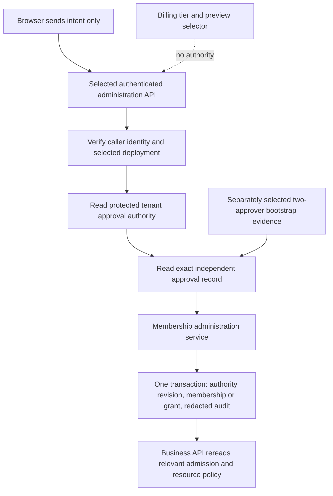

# Proposed identity adoption contracts

Status: **artifact design reviewed; runtime disabled and unadopted**. Prepared **2026-10-15** for WX-0511, WX-0527, WX-0534 and WX-0637 only. Agent 0 reviewed the proposed policy choices after independent source/artifact review. This records no catalog acceptance or operator setup. The [literal synthetic matrix](evidence/identity-adoption-matrix.json) preserves the original draft cases and metadata. See the [adoption index](ADOPTION-CONTRACTS.md) and [source-review record](evidence/adoption-contract-source-review.json).

Historical drafting basis: `42818dd7baf3d335f27c401c37d048bd842617fa`, supplied by Agent 0 while mandatory CI was running. The original preparation read the then-current public files and captured their exact hashes; it did not independently verify Git, execute identity workflows or infer that CI outcome. Those observations and the historical catalog hash remain unchanged in the companion matrix. A later source re-review after the CRM integration freeze is still pending; this curation makes no new runtime claim.

All policy names, numeric limits and synthetic approvals below are **proposals**. Actual service principals, Firebase project, approving people, issuer, factor verifier and policy revision remain **unselected**. Reviewing this artifact would accept a design scope only. It would not provision membership, mint a token, activate step-up, deploy a rule or prove adopted runtime enforcement.

## 1. Exact criterion mapping

| Proposal | Original acceptance criterion, unchanged | Concrete artifact coverage | Local paper examples | Remaining adoption boundary |
| --- | --- | --- | --- | --- |
| WX-0511 | For optional operator-approved adoption: A design records which backend creates memberships, who can approve assignments and how client-controlled role fields are ignored. | Sections 3–4 name the logical writer, separate approving authority, bootstrap and closed request contract. | MEM-01–MEM-12 | Operator chooses actual principals and approvers; administration and transaction enforcement remain unimplemented. |
| WX-0527 | For optional operator-approved adoption: The contract requires trusted issuer identity, audience, lifetime and scope while keeping token generation outside browser code. | Section 5 separates the server issuer, Firebase exchange custom JWT, Firebase ID token and external OIDC identity. | TOK-01–TOK-14 | Issuer/project/key custody and verifier composition require selection, implementation and scoped downstream evidence. |
| WX-0534 | For optional operator-approved adoption: A reviewed design groups CMS publication, CRM assignment and HR administration capabilities without deriving them solely from paid account level. | Section 6 defines three finite, separately scoped bundles using the WX-0501 vocabulary and WX-0503 membership boundary. | BND-01–BND-14 | Agent 0 artifact-design review is complete; operator adoption remains unselected, with no bundle assignment store or authorization adapter installed. Original dependencies WX-0501 and WX-0503 remain unchanged. |
| WX-0637 | For optional operator-approved adoption: An adoption matrix identifies which sensitive export or owner action should require recent authentication and leaves enforcement disabled until reviewed. | Section 7 lists eight sensitive action families, evidence, age bounds and refusal behavior. | STP-01-A–STP-08-D and STP-X1–STP-X7 | Enforcement stays disabled. A selected adopted operation needs a reviewed implementation and its own evidence; current demo behavior remains unchanged. |

The matrix has **79 literal cases**: 12 membership, 14 issuer, 14 bundle and 39 step-up examples. Expected decisions were written for this proposed contract; no implementation generated them and no authorization evaluator was run. An `allow` row admits a fictional paper example only. Each isolated denial stipulates a decisive failure while ordinary conditions not varied in that row remain assumed valid; this is a review matrix, not a complete request corpus for a deployed verifier. Synthetic verification/approval fields are explicit fixture stipulations, never browser assertions a server could trust.

## 2. Foundation observed at the historical source basis

| Current source | Observed boundary | What it does not establish |
| --- | --- | --- |
| `src/auth/firebaseAuth.ts:25,87` and provider registry | Custom-token sign-in checks provider readiness, refuses that production provider in the emulator lane, and sends a nonempty token to Firebase. | A token issuer, signing key, issuer/audience/scope contract, recent-authentication policy or adopted tenant grant. Registry “supported” describes template API support, not a selected deployment. |
| `src/auth/accountLevels.ts:94` | Account levels produce account/presentation and packaging flags, including `requiresMfa`. | Tenant membership, a verified second factor, an authentication timestamp or permission for a portal resource. |
| `integrations/gusto/functions/src/security.mjs:15` | Verified UID must match an active server-managed membership in the requested organization, with recognized HR roles. Mappings come from that record. | Client level, `admin`, submitted role or person/company fields do not create HR authority. The helper is not a membership provisioning endpoint. |
| `integrations/gusto/functions/src/index.mjs:44` and `backend.mjs:25` | The callable derives UID from `request.auth`, refuses unexpected fields and loads membership server-side. | The current service has no accepted membership-administration endpoint, new revision enforcement or cross-portal grant service. |
| `integrations/gusto/firestore.rules:59` | Optional reference rules deny browser access to the HR membership registry. | These optional rules are separate from root Firebase configuration. Server/Admin operations still need their own authorization policy. |
| `docs/TENANT-MEMBERSHIP-PROPOSAL.md:32,73,132` | WX-0503 proposes revision/concurrency and trusted administration, with five required membership fields and three optional mappings. | Those additions are not current enforcement. Actual service identity and approving authority are still unselected. |
| `src/cms/model.ts:127`, `release-bundles.ts:41` | Native publication requires a recognized publisher and an exact current, separately approved revision; release captures have additional freshness checks. | Fictional actor selection does not authenticate a real publisher or implement tenant storage. |
| `src/crm/model.ts:141`, `ownership.ts:30` | Native lead assignment is implemented for owner/sales-manager previews, an unconverted lead, current expected owner and an eligible fictional assignee. Account transfer is a separate graph operation. | A real membership or cross-tenant assignment service. A less explicit old table must not erase the actual assignment source behavior. |
| `docs/PORTAL-CAPABILITIES.md`, backup codecs | `read`, `create`, `approve`, `publish`, `export` apply to actor/resource/action/state. Native complete exports are broader than visible role projections. | A paid tier, read-only page, route or demo role does not make a complete backup safe for an adopted data classification. Current native exports are not step-up protected. |
| Root `firestore.rules` / `storage.rules` | Root account-level/admin policies are separate existing template policies. | This proposal does not strengthen those rules or claim that global account checks already enforce the tenant contract below. |

Current optional Gusto reference policy does not forward provider requests or execute payroll. Proposed portal capabilities confer no provider scope or connection. All source observations above are local source review, not deployed policy observations.

## 3. Proposed selection record and trust flow — WX-0511

Before an adopted implementation is enabled, its operator records one versioned selection outside reusable template state:

| Selection | Required concrete value before adoption | Present fact |
| --- | --- | --- |
| Deployment | Environment, selected Firebase project and intended tenant registry | Unselected |
| Membership writer | Exact execution service principal and deployed logical membership-administration service; permission restricted to selected membership/grant/audit stores | Unselected |
| Assignment authority | Protected, independently reviewed registry of who may approve which tenant, role/bundle and subject population | Unselected |
| Initial tenant authority | Two distinct deployment-selected bootstrap approvers and protected evidence tying their decision to the exact first tenant and first subject | Unselected |
| Issuer and verifier | Selected service-account signing identity, verifier project and approved upstream authentication mapping | Unselected |
| Step-up | Accepted authentication/factor evidence adapter and policy revision | Unselected; enforcement disabled |

“Operator” here is a role in a proposed downstream review process. This draft supplies no person's identity, organization ownership, signatures or approval. Service execution privilege and human assignment approval are separate records. Possessing an Admin credential or the `employer-owner` label is insufficient to become an assignment approver.

### Logical backend and closed operation contract

The proposed **TenantMembershipAdministrationService** is the only membership writer. It is a logical future backend contract, not a new endpoint installed by this artifact. Its closed membership operations are `create-inactive`, `activate`, `replace-roles`, `replace-mappings`, `set-inactive`. The first-tenant bootstrap uses separately authorized `bootstrap.create-inactive` and `bootstrap.activate-owner` operations. Cross-portal grants use their separate record described in section 6.

The service accepts bounded intent identifiers: schema version 1, tenant ID, target UID, operation, request ID, approval ID, expected membership revision and a redacted reason of 2–500 characters. Requested roles/mappings are intent for review, not authorization. The service retrieves the protected approval itself and compares the exact canonical intent, tenant, subject, requested role/mapping set, expected revision, requesting UID, approving UID(s), expiry and policy version. A browser `approved: true`, approval-shaped JSON or role/tier field cannot replace that protected record.

For compatibility with WX-0503, membership records retain its five required fields (`orgId`, `uid`, `roles`, `status`, `revision`) and optional `personId`, `gustoEmployeeUuid`, `gustoContractorUuid`. The proposed service validates exact shape, finite recognized HR roles, tenant-owned mappings and safe monotonic revisions. It does not insert CMS/CRM roles or bundle fields into that record.

### Approval and bootstrap rules

- Ordinary assignments need a distinct approving UID whose protected assignment-authority record covers this tenant, operation and exact requested grant. The requester cannot approve their own request, even when they are a tenant owner.
- Assignment-approver authority is separately provisioned by the selected deployment control plane. No ordinary membership or bundle automatically grants it. Changes to that registry need its own independently approved control-plane procedure.
- Intake creates an **inactive revision-1** record. Activation advances to revision 2 after approval. An initial first owner requires the two selected bootstrap approvers for its exact activation; “first user to sign in”, paid signup, matching email/domain or a client owner flag does not bootstrap authority.
- Existing membership changes compare `expectedMembershipRevision` inside the transaction. The accepted change and protected audit advance the current revision once. A stale request fails without silent rebase. A retry needs reload and deliberate review.
- Removing the last active tenant owner is refused unless an explicitly approved replacement is activated atomically under the adopted owner-transfer policy. Initial-tenant bootstrap cannot serve as an existing-tenant recovery path. This draft provides no lost-owner recovery override. WX-0517 remains a separate runbook scope.
- Person/provider IDs are resolved and checked against the same tenant. An email address or known external UUID is not ownership evidence. Cross-tenant movement creates a separately approved membership; it never rewrites this record's UID/org tuple.
- Business operations resolve actor UID from verified authentication. CMS/CRM admission reads the active, scoped `portal_grants` record; it requires and grants no HR role. HR admission additionally reads the current active HR membership, its allowed HR role and person/resource policy. Each operation reads its relevant required grant and resource ownership. Client `uid`, `roles`, `role`, `level`, `admin`, employee/company IDs and selector state are ignored as authority; unexpected transport fields are refused. Legitimate target identifiers remain untrusted intent to validate.
- Revocation advances authority revision and disables future admission. Pending work rechecks before its consequential step. This is a proposed concurrency rule, not a guarantee currently supplied by the reference backend or an atomicity guarantee for external providers.

The proposed protected audit records request/approval IDs, actor and approver UIDs, tenant, operation, target, old/new revisions, policy revision, result, server time and a bounded redacted reason. It excludes credentials, bearer tokens, private personnel text and provider payloads. Retention and access ownership remain downstream selections.

## 4. Membership example outcomes

`MEM-02` permits an independently approved fictional inactive intake; it does not activate an owner. `MEM-04` separately models approved first-owner activation. `MEM-05` models an ordinary tenant-approved employee activation. Wrong tenant (`MEM-07`), self-approval (`MEM-06`), forged level/admin/roles (`MEM-08`), cross-tenant mapping (`MEM-09`), stale revision (`MEM-10`), browser approval boolean (`MEM-11`) and last-owner removal (`MEM-12`) each deny without a membership change. The deployment remains unselected in `MEM-01`, so no real bootstrap service is available.

## 5. Proposed server-only custom-token issuer — WX-0527

The future issuer authenticates an upstream identity by an operator-selected method, maps that proven identity to the intended Firebase UID, and authorizes that exact sign-in. Its selected signing principal and verifier project are configuration controlled by the operator; neither is chosen from request parameters. Key custody, rotation, compromise handling and revocation ownership must be named before adoption. No private key, Admin credential, signing implementation, token-generating code or literal bearer token belongs in browser code, public fixtures, logs or this artifact.

### Do not mix three token contracts

| Token kind | Intended consumer | Issuer/audience checks |
| --- | --- | --- |
| Firebase **custom JWT for sign-in exchange** | Firebase `signInWithCustomToken` exchange | For the documented custom-JWT format, signing uses RS256; `iss` and `sub` identify the selected project's service-account email. The documented audience is `https://identitytoolkit.googleapis.com/google.identity.identitytoolkit.v1.IdentityToolkit`, not the app origin, tenant ID or Firebase project-ID audience used below. |
| Firebase **ID token after sign-in** | The selected application's verified identity boundary | Verify signature, valid times and selected project. Its `aud` is the Firebase project ID and `iss` is `https://securetoken.google.com/<projectId>`. The verified subject supplies UID; portal grants, applicable HR membership and resource permission still come from current server policy. |
| External OIDC **ID token** | Its separately registered relying party | Exact selected issuer, registered client audience and applicable signature/nonce/time checks belong to that OIDC verifier. It is not automatically a Firebase ID token or a portal grant. An adopted exchange/mapping needs separate review. |

These protocol distinctions are from [Firebase custom tokens](https://firebase.google.com/docs/auth/admin/create-custom-tokens), [Firebase ID-token verification](https://firebase.google.com/docs/auth/admin/verify-id-tokens) and [OIDC Core ID-token validation](https://openid.net/specs/openid-connect-core-1_0.html#IDTokenValidation), reviewed 2026-10-15. In particular, Firebase's ID-token verifier is not a custom-token verifier. This table does not prescribe replacing Firebase's supported SDK verifier with a handwritten JWT parser.

### Proposed lifetime and scope

- Accept only a selected trusted server signing profile. Validate upstream authentication and UID mapping before issuance. Reject malformed, wrong-signer, unknown-algorithm or request-selected issuer/project inputs.
- Require integer `iat`/`exp`, `exp > iat`, no future-issued token under this strict proposed policy, and **at most 3,600 seconds** between issuance and expiry. Do not deliver an already expired token. This bound matches Firebase's documented maximum; it is not a claim that the browser wrapper validates those fields.
- The proposed additional-claims allowlist is **empty**. The issuer's scope is authentication of the mapped UID in the selected Firebase project. It cannot mint tenant roles, paid tier, bundle grants, provider access or recent-authentication assurance. Firebase custom tokens are not OAuth access tokens with arbitrary API `scope` semantics.
- Expiration bounds use of the custom JWT for sign-in. It does **not** bound the resulting device session to that period. The adopted API separately verifies ID tokens and applies its revocation/session policy. Firebase documents the longer-lived session/refresh-token distinction and optional revocation verification in [Manage User Sessions](https://firebase.google.com/docs/auth/admin/manage-sessions).
- Browser transport, caching, leakage prevention and issuance-request replay/rate policy need implementation review before selection. This draft does not promise that Firebase custom JWTs are natively one-use. A separately bound request/nonce is not a change to Firebase's protocol audience.

`TOK-02` is unsigned metadata for a paper issuance decision, not a usable JWT or accepted issuer. `TOK-03`–`TOK-10` supply independent issuer/audience/shape/expiry/lifetime/browser/scope/signature denials. `TOK-11` denies a custom JWT used as an application API bearer. `TOK-12` denies a Firebase ID token for another project; `TOK-13` establishes only a hypothetical verified UID, not organization access. `TOK-14` keeps a generic external OIDC token outside the Firebase boundary.

## 6. Proposed portal permission bundles — WX-0534

Use the existing vocabulary **read / create / approve / publish / export**, and evaluate **actor + tenant + resource + action + current state**. Each bundle is a versioned allowlist, never a global admin bit. Account levels remain packaging/presentation inputs. A paid feature can additionally require its product entitlement, but entitlement alone never satisfies a bundle or tenant grant. A legitimate free-tier subject can hold an explicitly approved grant when the adopted product permits that workflow.

Cross-portal grants belong in a **new proposed protected** `organizations/{orgId}/portal_grants/{uid}` record. Do not add fields to the current exact HR membership proposal or insert CMS/CRM names into `HR_ROLES`. A proposed grant has `schemaVersion: 1`, matching `orgId`/`uid`, active/inactive status, safe monotonic revision and 1–8 assignments. Each assignment names an exact bundle ID and version plus its explicit collection/person/resource scope; lists contain at most 100 distinct identifiers, with no implicit wildcard. The same independently approved administration boundary controls these records. Browser writes are unavailable until separately implemented and reviewed. This active, scoped record is the proposed CMS/CRM tenant admission record; a CMS-only publisher needs no HR membership and receives no HR access. HR operations require both this relevant grant and the separate active HR membership/role/resource checks. There is no invented generic membership record or automatic nonempty HR role requirement for CMS/CRM users.

| Proposed bundle | Literal capabilities | Required resource/state conditions | Explicit exclusions |
| --- | --- | --- | --- |
| `cms-publication-v1` | `cms.entry.publish`, `cms.entry.retire`, `cms.release.activate` | Bound tenant; allowed collection/entries; exact current approved revision and distinct author/reviewer; release activation must preserve captured-member freshness and route collision checks. | No authoring, review approval, membership administration, complete export or other portal access. |
| `crm-assignment-v1` | `crm.lead.assign` | Bound tenant; allowed lead scope; unconverted new/qualified lead; current expected owner; active eligible same-tenant destination assignee. | No converted account-graph transfer, opportunity editing, bulk export, HR or CMS authority. Account transfer requires a separately defined capability/contract. |
| `hr-person-admin-v1` | `hr.directory.read`, `hr.person.directory.read`, `hr.profile-email.update`, `hr.onboarding.admin` | Bound tenant and explicit person population; required trusted person mapping; adopted HR role policy and current workflow/validation checks. Directory data is distinct from compensation/restricted/private data. | No compensation grant, payroll execution, provider connection, membership/bundle administration, self/manager impersonation or complete export. |

The bundle IDs and capability strings are proposed adopted-policy names. Native seed actor IDs cannot become production principals. An adopted adapter must resolve trusted actor/person/collection mappings and preserve domain constraints; the existing native helpers and broader optional HR read classifications are not already enforcing these bundles.

Bundle composition is the union of explicitly granted actions **intersected** with tenant, resource, field-classification and workflow constraints. A union never disables CMS separate review, HR own-person/manager checks or CRM ownership checks. Membership and grant revision plus bundle catalog version are revalidated for consequential operations. A version-2 bundle expansion cannot enlarge version-1 assignments silently; it needs explicit migration review and regrant.

Full exports use separately approved export capabilities in section 7. A `read` grant is not an export grant, and a future filtered export must declare its schema and exclusions. It cannot be described as the current complete native backup.

`BND-01`, `BND-04` and `BND-08` model narrow publication, lead assignment and HR profile operations. `BND-13` admits a scoped CMS-only publisher with no HR membership; `BND-14` retains an unchanged capability from an accepted version-1 bundle while version 2 also exists. `BND-12` denies a version-2-only compensation capability to the version-1 grant. The other cases deny stale/separation failures, cross-portal and cross-tenant reuse, account-transfer overreach, provider execution, paid-only access and silent policy-version expansion. No bundle is assigned by this draft.

## 7. Proposed recent-authentication and step-up matrix — WX-0637

**Enforcement state: disabled-unadopted.** This is a design value, not an added runtime flag. Current account-free native selectors and complete backup downloads keep their current behavior. The proposed adopted sensitive endpoints below do not exist merely because the matrix names them. They must remain unavailable in an unconfigured adopted feature until the operator reviews the policy and its implementation; this statement does not claim current demo exports have that gate.

Proposed common recency: a server-verified authentication event is **0–300 seconds old** at the consequential step, with no future time admitted by this strict proposal. For every action below, a selected trusted factor adapter must additionally verify a second-factor event that is independently **0–300 seconds old** at the consequential step and bound to the same UID and authenticated session. A missing, future or older factor-event time denies, even when primary authentication and the action challenge are recent; the challenge lifetime does not refresh factor assurance. A server-verified ID-token `auth_time` can contribute to recency; a new token `iat`, force refresh, browser clock, `requiresMfa`, checkbox or client `mfa: true` cannot prove a new authentication/factor event. Custom-token sign-in alone does not establish recent interactive authentication unless the selected upstream assurance adapter independently proves it.

Firebase documents `auth_time` and ID-token validation separately from refresh/revocation. OIDC also distinguishes authentication age and assurance context; this contract does not assume a universal Firebase `amr`/`acr` mapping or that any custom claim proves MFA. The selected evidence adapter must document its actual factor semantics. See [Firebase ID-token checks](https://firebase.google.com/docs/auth/admin/verify-id-tokens), [session/revocation management](https://firebase.google.com/docs/auth/admin/manage-sessions), and [OIDC authentication-age/context validation](https://openid.net/specs/openid-connect-core-1_0.html#IDTokenValidation).

| Sensitive adopted action | Separately approved capability | Scope/effect to bind before release | Proposed proof and refusal |
| --- | --- | --- | --- |
| `cms.export.full` | `cms-full-export-v1` | Tenant, exact collections/resource set, complete unpublished/editorial/feedback payload classification | Recent authentication + trusted second factor; deny stale, missing evidence or wrong tenant before serializing any bytes. |
| `crm.export.full` | `crm-full-export-v1` | Tenant and complete ownership graph, including other representatives' saved records | Same proof; a representative's read projection or paid level is insufficient. |
| `hr.export.full` | `hr-full-export-v1` | Tenant, complete saved HR graph including private drafts/compensation where present | Same proof plus approved full-data export authority; read-only/auditor UI does not make complete export public. |
| `workspace.export.combined` | `combined-full-export-v1` | Every selected tenant/module, exact module set, payload classification and all module-specific export grants | Same proof, deny the whole request if any selected module fails; no unreviewed partial fallback. |
| `tenant.owner.assign` | `tenant-owner-administration-v1` | Exact tenant/subject/owner grant, current authority revisions and independent approval | Same proof; no self-approval; late authority change refuses before mutation. |
| `tenant.owner.revoke` | `tenant-owner-administration-v1` | Exact owner removal/transfer and last-active-owner invariant | Same proof plus independently approved safe replacement; no last-owner bypass. |
| `tenant.owner.recover` | `tenant-owner-recovery-v1` | Exact restoration/elevation target and separate accepted recovery evidence | Same proof plus independent recovery authorization under the separately reviewed recovery procedure. Missing recovery evidence always denies; no recovery service is supplied here. |
| `identity.issuer-policy.replace` | `issuer-policy-administration-v1` | Exact environment/project, signer/verifier policy replacement and independent control-plane approval | Same proof bound to old/new policy versions; a tenant owner bundle alone does not grant signing/IAM control. |

### Action-bound evidence and retries

A future selected server issues a protected, opaque challenge bound to UID/session, tenant, exact action, resource/module set, canonical intent digest, membership/grant/catalog revisions and server expiry. Proposed challenge lifetime is **120 seconds maximum**, one accepted use, consumed atomically with the local consequential operation. This is a future server capability, not token code in this draft. Cancellation/expiry releases no data and creates no authority change. A changed intent, tenant, role, membership/grant revision, factor evidence or recovery approval invalidates it.

On reauthentication or MFA refusal, retain safe pending intent for deliberate retry and deliver no export payload. Re-read membership, resource and approval state after successful step-up and immediately before the consequential step; do not silently replay a queued owner action. A consumed challenge cannot be replayed. If an external provider action is ever added, local challenge consumption does not make its external effect transactional; that requires its own accepted idempotency/recovery contract.

Cases `STP-01` through `STP-08` independently name all eight actions. For each, suffix A models current hypothetical evidence; B denies 301-second-old authentication; C denies missing trusted factor evidence despite browser booleans; D denies another tenant. `STP-X1` keeps unadopted enforcement unavailable in the modeled adopted feature, X2 rejects fresh-token/old-auth confusion, X3 rejects future auth time, X4 rejects replay, X5 rejects changed authority, X6 rejects missing recovery approval, and X7 rejects a 301-second-old factor event despite recent primary authentication and a current unused challenge.

## 8. Review, adoption and evidence boundary

The concrete artifact review may assess the original four design criteria without pretending that an adopted service exists. Agent 0 has reviewed this artifact design; actual operator adoption approval remains unselected. Real adoption requires actual principal/approver/project selections, reviewed migration and deny-by-default APIs, server transaction and revocation behavior, accepted signer/verifier/factor composition, and scoped evidence for the selected environment. This list describes the separate implementation boundary; it does not change the four original artifact criteria or create new catalog dependencies.

Agent 0 reviewed the following proposed design choices. Actual downstream selections and implementation still require their own operator review:

1. Confirm the proposed assignment-approval and two-approver bootstrap model; actual approving identities remain unassigned.
2. Confirm empty custom-token additional claims and selected signer/project/UID mapping. If nonempty claims are later needed, review their protocol limits and authority implications explicitly.
3. Confirm exact bundle capabilities/scopes and versioning; do not retrofit them silently into current HR role records or seed actors.
4. Confirm the proposed 300-second primary-authentication and separate 300-second factor-event recency, 120-second challenge and trusted-factor requirements for each of the eight action families. They are local policy proposals, not Firebase defaults or operational guarantees.
5. Keep complete-native-export exposure explicit while designing adopted export authority. No deployed rules, signed token or current paid-tier flag is evidence of these proposals being enforced.

The source inventory in the companion data records 19 exact-byte file hashes and the canonical catalog hash. Recheck on changes to those files, Firebase authentication documentation, selected upstream authentication/factor semantics, or the bundle/action policy. The original audit was a planning input; the original draft used the source read at that historical basis and did not promote an older baseline into runtime evidence. This curation preserves those observations; a later source re-review is separate.

## 9. Source references

Repository-relative references below identify the files observed at the historical source basis; hashes are preserved in `sourceReview.files` of the companion data. No private path, secret, account recovery material or token is embedded. Official protocol links were checked on 2026-10-15 and may require refresh before downstream adoption.

- `src/auth/firebaseAuth.ts` — SHA-256 `b8672f40e1bab47fd77f7f60407d864af96df4d3efd12b548d3a157749dcf867`.
- `src/auth/authProviders.ts` — SHA-256 `a4b4a79fe9f4bdd0164d6b99386da37dc40fddd3ecd43f111250e11ea142dabc`.
- `src/auth/accountLevels.ts` — SHA-256 `38784a0cca7570cc5c2ef456e44d19e0c053311579002a2ee7d6d50dc831f270`.
- `.SYSTEMX/LAN/Builder/contracts/auth-provider-registry.json` — SHA-256 `5e26bd49c426431816a8695c8847a4f9c84d388572c5825c400d47955dc58a9e`.
- `integrations/gusto/functions/src/security.mjs` — SHA-256 `48c86c7be0c53c47b0c520a6b2d2162e1d1f151423b9d7f04413dc3159b518f5`.
- `integrations/gusto/functions/src/index.mjs` — SHA-256 `fa240bf40cf6acb9e305c07275dd190ace393fd33b2edbbb263a024f86f92fed`.
- `integrations/gusto/functions/src/backend.mjs` — SHA-256 `652af6bdc7ddba6820a3d47f6eda9514e4555b0c8d1a124c5f733232c5386efa`.
- `integrations/gusto/firestore.rules` — SHA-256 `946fa2a7bba43f33925c367bf52f0139c558f4192bbe6a8e82de7bc8cc2f4352`.
- `docs/TENANT-MEMBERSHIP-PROPOSAL.md` — SHA-256 `0a71c4c3a738059dbf367c3521f1b67ebb941a4206c101761405a8568a79e267`.
- `docs/PORTAL-CAPABILITIES.md` — SHA-256 `145d912322bd3d4e9ffce7a8ca45131c1fd557f8801ef9d36ed348934368f6cd`.
- `src/cms/model.ts` — SHA-256 `2bd7580d3fd0e42a27810fe65ccf04aae0e3a2a69ac01df05a7acc9c7cf28bbf`.
- `src/cms/release-bundles.ts` — SHA-256 `ed159266af4cf6346cc49506d8e55d80e5c090e48c67c0001e718bad96c9ab24`.
- `src/crm/model.ts` — SHA-256 `fbef9b656e5e286d3a6a22a93487a905e7909482b64972a33c5c90d86e91bed8`.
- `src/crm/ownership.ts` — SHA-256 `513a052d85d9f3107869b71ed4fd8c71b35da484111fd44f7a123da045ed6ab0`.
- `src/hr/model.ts` — SHA-256 `32c3a83203c4a07a5cee5bb0d244a252f32992da71eef2b2cf61f3170e9e1f4e`.
- `src/portals/backup.ts` — SHA-256 `b65026ffc361a10b03a9585ae720d54f9c14f53f0ea5c9bf2b3c6dad53a26a1a`.
- `src/portals/combined-backup.ts` — SHA-256 `186c9b29a0ce2d74b81bacba0713675ea85713bc452d1ee6a5dc26927b96a726`.
- `firestore.rules` — SHA-256 `da607c38e2acb644763722887c6286e1c33ba3c98edf845d36c23a8e2825d482`.
- `storage.rules` — SHA-256 `858a8d5ad0af31ad5c9b42650ca58f6a2601b22e20464b63d636ad3f32503f83`.
