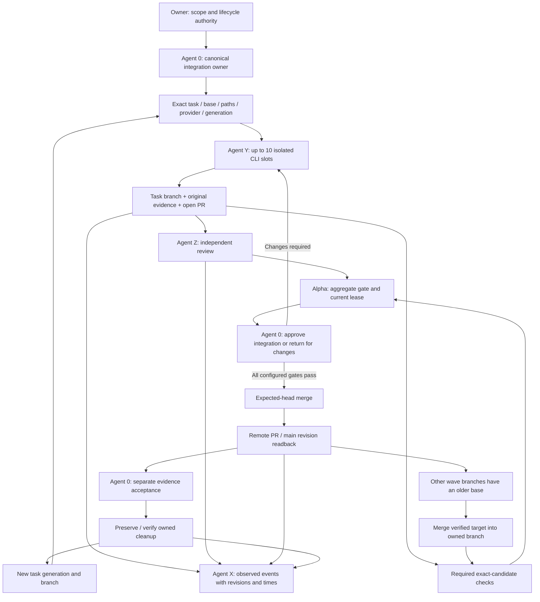

# SYSTEMX swarm operational map

This is WebAppX's host-owned swarm map. The reusable
[project map seed](../.SYSTEMX/PLAN/MAP.md) remains blank. Read the
[swarm guide](SYSTEMX-SWARM.md),
[access matrix](SYSTEMX-SWARM-ACCESS-MATRIX.md) and
[managed integration boundary](SYSTEMX-INTEGRATION.md) together.

## Coordination flow

Alpha evaluates the policy and observations; it does not widen authority or own
canonical main. The diagram describes permitted transitions. Runtime state and
provider readback determine which transitions actually occurred.

## Source and record boundaries

| Area | Owner and purpose | Preservation rule |
| --- | --- | --- |
| `.SYSTEMX/.systemx/releases/1.9.0-alpha.6/` | Immutable selected universal instructions/tools. | No host swarm change edits its files or manifests. |
| `.SYSTEMX/swarm/cli.mjs`, `runtime.mjs` | Host command surface, manifest validation and lifecycle support maintained by WebAppX. | Review and test changes separately from upstream release integrity. |
| `docs/SYSTEMX-SWARM*.md` | Host operating contract, map and access decisions. | Record actual implementation and evidence scope; do not populate blank seeds. |
| `.SYSTEMX/docs/AGENT-X.md`, `AGENT-Y.md`, `AGENT-Z.md` | Host role guidance beside selected defaults. | Host additions explain the separate swarm lane; selected managed commands retain their original behavior. |
| `.SYSTEMX/AGENTS/README.md` | Host coordination and integration responsibilities. | Agent 0 remains canonical writer; role records remain separate from live processes. |
| Adopted project's `WORK/TASKS.json` | Canonical task state after deliberate project adoption. | WebAppX's reusable ledger remains blank; a swarm receipt is not a duplicate completion ledger. |
| Ignored `.SYSTEMX/state/swarm/<runId>/` or explicit private state directory | Private assignment sidecars, generation state, leases, completion hashes, events and verified retirement bundles. | No tokens, absolute local paths or private provider output in tracked release records; readable original evidence and backups require separate retention. |
| Task worktrees and branches | One generation and one bounded write owner each. | Preserve unmerged/dirty work; reuse worker slots only through new generations. |
| GitHub PR and required checks | Provider delivery/verification observations. | Recheck exact head/base and protection state before integration; read back merge and cleanup. |
| Mac IDE / Codex app | Separate runtime surfaces reading a revision-bound handoff. | Invalidate stale handoffs; a visible file or chat is not synchronization proof. |
| `integrate` / `advance` | Per-worker target integration versus next-wave coordinator sync barrier. | Merge only into an owned clean branch; invalidate checks/Z/Alpha. New generations wait for all slots closed and clean local/base/remote agreement. |

## Handoff boundaries

| From → to | Minimum retained facts | Freshness invalidator |
| --- | --- | --- |
| Agent 0 → Agent Y | Repository, task, base, allowed paths, provider, generation, branch/worktree, budgets and checks. | Base drift, occupied ownership, changed provider identity or changed scope. |
| Agent Y → Agent Z | Exact head, diff scope, task criteria, original terminal test evidence and known failures. | Source/evidence changes after review. |
| Agent Z/checks → Alpha | Independent review disposition and exact-candidate required check results. | Pending/failed/stale checks, unresolved findings or changed candidate. |
| Alpha → Agent 0 | Current lease and bounded integration conclusion with original observations. | Expiry, changed head/base/repository, competing writer or missing evidence. |
| Agent 0 → GitHub | Immediate REST merge request bound to the expected head after serialized checks/lease/protection gate. | Retarget, conflict, changed head/base, active owned execution or provider refusal. No deferred queue or uncertain-write retry. |
| GitHub → cleanup | Verified merged PR, target revision and exact owned branch head. | Dirty/unpushed work, branch movement, missing recovery artifact or unclear ownership. |
| Mac IDE ↔ Codex | Repository/checkout, branch/revision, generation, dirty-state observation, owner, evidence and next action. | Any material source, generation, branch or ownership drift. |

Record meaningful transitions through Agent X with original evidence. A
proposed transition, an event label or a saved handoff never proves process,
provider or IDE execution.

## Runtime qualification limits

The CLI records Z review and Alpha/Agent 0 evidence digests as operator
assertions; it does not authenticate those identities or inspect the referenced
review artifacts. It enforces freshness/consistency and requires GitHub's
independent remote approval/protection observations before requesting merge.
Its default close retains branches/worktrees. Optional deletion refuses ignored
worktree data, creates/verifies a private Git bundle of the exact original
worker ref/head within a 128 MiB regular-file budget, records its SHA-256,
rechecks origin and verifies remote branch absence before owned local removal.
Ignored files require separate preservation. Execution sidecars retain observed
PID/group/controller/generation/lease facts before packet delivery. A controller
crash needs manual ownership audit; stale records grant no automatic kill or
retry authority. Local fixture results do not establish authenticated provider
concurrency, real publication, merge, deletion or IDE acceptance.
