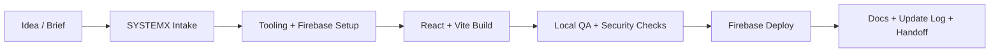
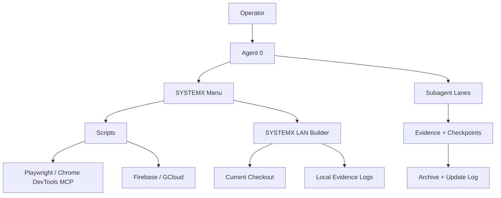

# WebAppX Wiki

Unified webapp release **3.4.0** uses standalone SYSTEMX **1.9.0-alpha.6**.
This wiki belongs to WayneTechLab/WebAppX; public dotSYSTEMX remains the
universal upstream. Start with [Standalone SYSTEMX Integration](SYSTEMX-Standalone-Integration.md),
[Quick Start](Quick-Start.md), [Agent Y setup for a new app](Agent-Y-New-App-Setup.md),
and [Update Log](Update-Log.md).

## CRM merge and adoption contract candidate — verification in progress

The assigned batch covers **WX-0369–WX-0373** and seventeen adoption artifact
criteria. The [CRM walkthrough](CRM-Duplicates-and-Merges.md) explains scoped
duplicate reports, deliberate contact/company preview and apply, complete local
history, retained drafts and workspace recovery. The [adoption guides](Adoption-Contracts.md)
provide fourteen reviewed design/runbook artifacts with operator selections unconfigured.

This candidate starts from published source
`317f47806b7f86dce00f15ee5ced7c0e0bae6116`. Final browser, CI, Hosting preflight
and Agent 0 acceptance are pending. The canonical checklist remains **134 done /
866 remaining** and the complete 1,000-item goal remains active.

## Historical payroll and developer setup checkpoint — locally accepted

Agent 0 accepted **twelve original criteria**: **WX-0159/WX-0160** and
**WX-0011–WX-0014, WX-0016, WX-0019, WX-0020, WX-0022–WX-0024**.
Read the [payroll walkthrough](https://github.com/WayneTechLab/WebAppX/blob/main/docs/HR-PAYROLL-CONTROLS.md),
[setup contract plan](https://github.com/WayneTechLab/WebAppX/blob/main/docs/SETUP-CONTRACTS-IMPLEMENTATION-PLAN.md) and
[dated QA receipt](https://github.com/WayneTechLab/WebAppX/blob/main/docs/PAYROLL-SETUP-QA-2026-10-15.md) for exact acceptance and evidence.

Account-free payroll now supports explicit company-window closure and separate
cumulative monetary corrections linked to immutable original receipts. Employee
views show only their own adjustments; auditors use metadata-only Payroll
History. Complete saves, backups, selective restore and Undo retain these records.

Developer tools list all 134 real package scripts by purpose, validate maintained
npm examples, inventory fictional sources and Reset actions, report grouped
starter drift, and statically review child-process construction. Use
`npm run scripts:list`, `npm run docs:commands:check`, `npm run fixtures:list`
and `npm run source:shell:check`; see the command reference for effects and limits.

**All 68 CI stages passed with terminal exit 0** on committed source
`42818dd7baf3d335f27c401c37d048bd842617fa`. Independent review confirmed **211 actual browser
checks/check groups**: **197 common, 8 HR-disabled and 6 LAN**. The fresh payroll
suite passed **21 groups and all 35 status meanings**. Hosting preflight exited
**0** on that source; app **3.4.0** retains **deploy count 0**, with deployment skipped.

At that payroll/setup checkpoint, the catalog recorded **134 done / 866 remaining**: **56 P1, 654 P2
and 156 P3**, with **699 local, 127 operator and 40 provider** gates remaining.
The full 1,000-item goal remains active. Source/wiki publication requires its
separate direct remote parity check. These local results establish no provider,
production, native Windows or manual screen-reader acceptance.

## Historical recruiting lifecycle checkpoint — locally accepted

Agent 0 accepted **eleven original local criteria: WX-0201–WX-0210 and
WX-0951**. The [HR Recruiting Lifecycle walkthrough](HR-Recruiting-Lifecycle.md)
explains explicit adoption, approved requisitions, separate applications for one
person, scoped interviews/private scorecards, and preview-confirmed hiring into
onboarding. The typed optional provider adapter keeps native mock commands,
provider results, retry states and unsupported operations separate; mock mode
remains the default.

**All 63 configured CI stages passed with terminal exit 0** on committed source
`7337709b79b995c3f1e76254aa51fd86bbd1f215`. Independent report review confirmed
**198 actual browser checks/check groups**. Hosting preflight passed with exit
0 on that source. Deployment was skipped: app **3.4.0** retains **deploy count 0**.
Read the [dated recruiting QA receipt](https://github.com/WayneTechLab/WebAppX/blob/main/docs/HR-RECRUITING-LIFECYCLE-QA-2026-10-15.md)
for source/report bindings, executed scope and evidence limits.

At that recruiting checkpoint, the catalog recorded **122 done / 878 remaining**: **58 P1,
664 P2 and 156 P3**, with **711 local, 127 operator and 40 provider** gates
remaining. The complete 1,000-item goal remains active. Run `npm run browser:recruiting` after dependency
and Chromium setup to repeat the local fictional-workspace journey. These
results and the adapter contract establish no provider access, production
deployment, native Windows or manual screen-reader acceptance. Source and wiki
publication retain their separate direct remote parity checks.

## Historical confirmation checkpoint — locally accepted

Agent 0 accepted **WX-0708**, then its dependent **WX-0717**, for reversible-action
scope/effect/cancel previews and predictable Undo preview keyboard navigation
with exact opener focus return. Read the [confirmation QA receipt](https://github.com/WayneTechLab/WebAppX/blob/main/docs/PORTAL-CONFIRMATION-QA-2026-10-15.md)
and [state contract](https://github.com/WayneTechLab/WebAppX/blob/main/docs/PORTAL-STATE-CONTRACT.md) for the actual controls,
complete-record preservation checks and evidence limits.

**All 62 CI stages passed with terminal exit 0** on committed source
`998674759f11e17765c6724edfe2dae3d1c58c5a`. Independent stage/report review
confirmed **183 actual browser checks/check groups**: **169 common, 8 HR-disabled
and 6 owned LAN**. Hosting preflight passed on the same commit. App **3.4.0**
retains **deploy count 0**; no deployment occurred.

At that confirmation checkpoint, the canonical catalog recorded **111 done / 889 remaining**: **69 P1, 664 P2
and 156 P3**, with **722 local, 127 operator and 40 provider** gates remaining.
The full 1,000-item goal remains active. Source and wiki publication require
separate direct remote parity checks. These local results establish no provider,
production or manual screen-reader acceptance.

At that confirmation checkpoint, recruiting lifecycle work was in development
and **WX-0201–WX-0210 plus WX-0951 remained TODO**. The
[recruiting plan](https://github.com/WayneTechLab/WebAppX/blob/main/docs/RECRUITING-LIFECYCLE-IMPLEMENTATION-PLAN.md) retains the original implementation context;
the accepted recruiting checkpoint is recorded above.

## Historical lifecycle workflows — locally accepted

[Portal Lifecycle](Portal-Lifecycle.md) covers HR employment instances,
transfers/reasons/offboarding/rehire, directory corrections and checklist
versions, CMS release bundles and CRM ownership updates. Read the
[source guide](https://github.com/WayneTechLab/WebAppX/blob/main/docs/PORTAL-LIFECYCLE.md)
and [dated lifecycle QA receipt](https://github.com/WayneTechLab/WebAppX/blob/main/docs/PORTAL-LIFECYCLE-QA-2026-10-15.md).
Run `npm run browser:portal-lifecycle` after normal setup. App source is
integrated at `458a045`, followed by harness-only `fdf6012`.

Standalone native evidence passed **20/20 checks/check groups**, with **46 new
status meanings, 22 accessible-name audits, 129 control boxes, 20 literal value
probes and 22 Tab probes**. Targeted keyboard **9/9** and quality **6/6** runs
passed after documented native-picker/history harness corrections.

**At that historical lifecycle checkpoint, all 62 CI stages and 180 browser
checks/check groups passed** on `fdf60124e49659e9c33d30db59e45ff8369a38e1`,
with terminal CI exit 0. Hosting preflight passed on the same final runtime
before the harness-only commit; no deployment occurred. Agent 0 accepted the
sixteen feature criteria and audited **WX-0467/WX-0487**, eighteen local criteria.
At that lifecycle checkpoint, the catalog recorded
**109 done / 891 remaining**: **70 P1, 665 P2 and 156 P3**,
with **724 local, 127 operator and 40 provider** gates remaining. The later confirmation and accepted recruiting checkpoints are
recorded above. Original dated receipts retain their source, observation and
acceptance scope.

## Historical portal safety wave

The source wave starts at `532cc4ad63d18a4fe911b0a9b18e258b85ef3416`.
[Portal Safety and Recovery](Portal-Safety-and-Recovery.md) explains dirty-form
choices, the volatile CMS restored-editor exception, independent opt-in
import/Reset checkpoints and bounded structured differences. Read the
[safety QA receipt](https://github.com/WayneTechLab/WebAppX/blob/main/docs/PORTAL-SAFETY-QA-2026-10-15.md),
[state contract](https://github.com/WayneTechLab/WebAppX/blob/main/docs/PORTAL-STATE-CONTRACT.md),
[failure drill](https://github.com/WayneTechLab/WebAppX/blob/main/docs/PORTAL-RECOVERY-FAILURE-DRILL.md) and
[status inventory](https://github.com/WayneTechLab/WebAppX/blob/main/docs/PORTAL-STATUS-INVENTORY.md).

Run `npm run safety:test`, `browser:safety`, `browser:quality` and
`browser:recovery-drill` after normal setup. These are local fictional-workspace
checks. That dated receipt links all fourteen accepted local criteria;
provider and production gates retain their separate acceptance requirements.

At that historical safety checkpoint, Agent 0 accepted **14 original local criteria** and the catalog recorded **91 done / 909 remaining**: **82 P1, 670 P2 and 157 P3**, with **742 local, 127 operator and 40 provider** acceptance gates remaining. The full 1,000-item goal remains active.

**That safety checkpoint passed all 61 CI stages, 160 browser checks/check groups and Hosting preflight.** Its dated QA receipt records the source, retained reports, fixture corrections and local evidence limits. Production deployment was not performed. The historical lifecycle result is recorded separately above.

## Historical adoption and recorded-work checkpoint

That adoption and recorded-work wave accepted **WX-0851, WX-0852, WX-0855,
WX-0856, WX-0857 and WX-0858**, taking the catalog to **48 done / 952 remaining**.
Remaining priorities are **125 P1, 670 P2 and 157 P3**; remaining acceptance gates
are **784 local, 128 operator and 40 provider**. The full 1,000-item goal stays
active. Read [Testing & QA](Testing-and-QA.md#adoption-recorded-work-and-import-review-foundations)
and the [adoption QA receipt](https://github.com/WayneTechLab/WebAppX/blob/main/docs/SYSTEMX-ADOPTION-QA-2026-10-15.md)
for the accepted scope and evidence.

The [adoption workflow](https://github.com/WayneTechLab/WebAppX/blob/main/docs/BACKLOG-ADOPTION.md)
previews a bounded proposal selection and applies reviewed **TODO intake** to an
explicit adopted root or registered child. Credential availability, operator
authorization and local prerequisites are independent action gates; omitted or
unreviewed gates stay `unknown`. Recording TODO intake does not authorize
execution or transfer source completion evidence. The
[revision-impact report](https://github.com/WayneTechLab/WebAppX/blob/main/docs/BACKLOG-REBASELINE.md)
compares explicit committed source endpoints and requests review while preserving
catalog and task acceptance state.

The LAN builder's **AGI / Agent 0** panel and local React status card distinguish
reusable work seeds, roadmap proposals and explicitly selected recorded work.
The [work-status guide](https://github.com/WayneTechLab/WebAppX/blob/main/docs/WORK-STATUS.md)
explains default `not-selected`, exact root/child selection and `unavailable`
records. Readable empty records mean no work recorded; unavailable data does not
mean zero work. Exact stock-byte equality describes those files' content and
does not establish ownership, adoption or completion.

Inspect update boundaries with **`npm run systemx:provenance -- --format text --limit 40`**
and [the provenance guide](https://github.com/WayneTechLab/WebAppX/blob/main/docs/SYSTEMX-PROVENANCE.md).
Host-owned paths stay host owned when they match blank stock seeds; equality
grants no overwrite authority. The existing **`systemx:upstream:check`** command
now supplies a [bounded upstream review](https://github.com/WayneTechLab/WebAppX/blob/main/docs/SYSTEMX-UPSTREAM-REVIEW.md)
bound to the exact source commit and current canonical public main. The preview
reports preserved host paths and bootstrap conflicts, and applies no import.

Focused verification passed **95 host-integration tests, 19 revision-impact
tests, 37 work-status tests, six owned LAN browser checks and 13 CI-plan tests**.
That checkpoint’s source-derived CI plan had **46 stages**; planning did not run them.
**Integrated verification passed: all 46 CI stages, 62 browser checks and Hosting preflight.**
**Generated catalog/plan, link and preservation checks passed.** GitHub
publication uses final repository-identity and native-wiki parity checks. Local macOS evidence does not establish provider,
production, native Windows or whole-site accessibility acceptance.

At the historical operational-foundations checkpoint, the wave added **`environment:check`** for tracked public
examples, **`repository:identity`** for a read-only Git publication receipt,
and **`browser:payroll` / `browser:lifecycles`** for complete synthetic payroll,
CMS and CRM journeys. Read [Testing & QA](Testing-and-QA.md#operational-foundations-and-complete-portal-lifecycles)
and the [operational QA receipt](https://github.com/WayneTechLab/WebAppX/blob/main/docs/OPERATIONAL-FOUNDATIONS-QA-2026-10-15.md)
for the examined source, focused results and integration gates. Agent 0 then
accepted nine original criteria, taking the catalog to **42 done / 958 remaining**.
At that checkpoint, all **43 CI stages, 56 browser checks and Hosting preflight
passed**. Every browser report confirmed owned cleanup. These results and the
earlier 38-stage pass below retain their historical scope.

The new payroll fixture reconciles two statements and the actual combined export:
**17.75 hours, $532.50 gross and $401.00 net**. CMS checks the complete frozen
public preview after a later draft edit and reload. CRM checks linked conversion
and follow-up records; its removed form establishes UI prevention, while an
explicit browser-module probe separately verifies conversion replay refusal on
a detached actual download, without injecting application state.

Use the [configuration proposal](https://github.com/WayneTechLab/WebAppX/blob/main/docs/ENVIRONMENT-CONFIGURATION.md),
[repository receipt guide](https://github.com/WayneTechLab/WebAppX/blob/main/docs/REPOSITORY-IDENTITY.md),
[command effects](https://github.com/WayneTechLab/WebAppX/blob/main/docs/COMMAND-SAFETY.md),
[security assumptions](https://github.com/WayneTechLab/WebAppX/blob/main/docs/SECURITY-ASSUMPTIONS.md),
[QA coverage map](https://github.com/WayneTechLab/WebAppX/blob/main/docs/QA-COVERAGE-MAP.md)
and [health vocabulary](https://github.com/WayneTechLab/WebAppX/blob/main/docs/MONITORING.md)
when adopting these tools. Example validation supplies no runtime enforcement;
source, browser, owned-session, provider and deployed health need separate
evidence. Repository `clean-ahead` is a valid observation for already authorized
publication review, without granting publication or deployment authority.

The session/contracts wave adds fixed browser-save origins, independent app and
emulator readiness, a read-only restart preview, and source-backed portal state
and capability contracts. Use [Quick Start](Quick-Start.md#open-the-integrated-local-builder)
for `dev:systemx -- --host 127.0.0.1 --port 5185` and
`systemx:session:restart:preview`. The
[dependency installation guide](https://github.com/WayneTechLab/WebAppX/blob/main/docs/DEPENDENCY-INSTALLATION.md)
explains the root/starter and optional Functions runtime scopes.

Read the [state contract](https://github.com/WayneTechLab/WebAppX/blob/main/docs/PORTAL-STATE-CONTRACT.md)
for retained records, temporary inputs and navigation/reset/restore behavior,
and the [capability matrix](https://github.com/WayneTechLab/WebAppX/blob/main/docs/PORTAL-CAPABILITIES.md)
for synthetic role checks and complete demo backup contents. Run
`npm run browser:state-contract` for the isolated browser journey. The
[evidence index](https://github.com/WayneTechLab/WebAppX/blob/main/docs/BACKLOG-EVIDENCE.md)
attaches scoped reviews to stable catalog IDs without changing completion;
`npm run backlog:evidence -- --id WX-0717` retains evidence originally attached
while the item was pending. Its later acceptance is recorded above. Historical
session verification is recorded in the
[session/contracts QA receipt](https://github.com/WayneTechLab/WebAppX/blob/main/docs/SESSION-CONTRACTS-QA-2026-10-15.md).

At the historical accepted session/contracts checkpoint, the catalog reached **33 completed
and 967 remaining**. All **38 CI stages**, **36 browser checks** and Hosting
preflight passed; the receipt retains exact scope and platform boundaries.

The owner has authorized completing **all 1,000 catalog items**. The
[execution plan](https://github.com/WayneTechLab/WebAppX/blob/main/docs/WEBAPPX-EXECUTION-PLAN.md)
maps every stable ID into workstreams and dependency-aware waves. The goal stays
active until each original acceptance criterion has reviewed evidence. Use
`backlog:plan`, `backlog:ready` and `backlog:graph` to inspect local scope and
dependencies; these reports do not dispatch workers or change completion state.
Provider/operator criteria retain their item-specific proof and activation scope.

New foundations include a pinned **Node 24.22.0** / **npm 11.11.0** setup,
`development:check`, an isolated **`npm run dev:mock`** launcher, shared portal
cards/breadcrumbs/recovery pages and **Ready / Saved / Recovered / Unavailable**
save summaries. **`npm run ci:plan`** explains the actual CI stages and mutation
categories without executing them. Read [Quick Start](Quick-Start.md),
[Template Portals](Template-Portals.md#shared-directory-and-route-recovery) and
the [foundation QA receipt](https://github.com/WayneTechLab/WebAppX/blob/main/docs/EXECUTION-FOUNDATION-QA-2026-10-15.md)
for exact behavior and checked evidence.

At the earlier foundation checkpoint, accepted checks passed 15 development contracts, 14 launcher cases,
eight planner cases, 14 catalog cases and 121 portal model cases. CI planning
passed 13 cases and reported the then-current 34 stages without unknown classifications.
Nine foundation and nine existing keyboard browser checks passed with owned
cleanup successful. The receipt records final integrated publication gates.

New local developer checks: **`npm run doctor`** reports prerequisite versions
without installing tools; **`npm run --silent doctor -- --json`** provides structured
output. After `npm ci` and the explicit **`npm run browser:install`**, run
**`npm run browser:smoke`** for deterministic HR/CMS/CRM baseline, UI mutation,
refresh and complete-export checks in its own Chromium context and loopback
server. No provider account is needed. See [Quick Start](Quick-Start.md#check-tools-and-run-the-account-free-browser-smoke),
[Testing & QA](Testing-and-QA.md#automated-developer-and-portal-smoke-checks) and
the [developer/browser QA receipt](https://github.com/WayneTechLab/WebAppX/blob/main/docs/DEVELOPER-BROWSER-QA-2026-10-14.md)
for the checked scope and results.

Use **`npm run browser:keyboard`** for native onboarding and selective
restore/Undo journeys with real Tab traversal, Enter/Space, keyboard typing and
visible-focus checks. **`npm run browser:keyboard:test`** exercises the driver
guards. The new [keyboard guide](Template-Portals.md#keyboard-onboarding-and-recovery)
explains focus movement and return behavior; the
[keyboard QA receipt](https://github.com/WayneTechLab/WebAppX/blob/main/docs/KEYBOARD-PORTALS-QA-2026-10-15.md)
records the checked scope. Native file-picker operation, screen-reader behavior
and whole-site accessibility remain outside these authored journeys.

The keyboard wave passed **nine browser checks**, **11 keyboard guards** and
**16 existing seed/runner guards**, with 110 onboarding and 266 recovery focus
observations. Exact records/history survived reload, cancellation and selected
recovery; focus returned to the original Undo button or the history heading when
retention removed it. Cleanup closed both owned resources. See the receipt for
final publication gates.

Local verification passed 18 doctor cases, 16 seed/runner cases and all seven
authored browser checks, including a second clean context and successful owned
browser/server cleanup. Only the expected unconfigured-Firebase warning appeared;
independent source review had no unresolved findings. The receipt records final
publication-gate outcomes separately.

The [WebAppX roadmap](WebAppX-Roadmap.md) catalogs exactly **1,000 improvement
items**, 50 in each of 20 areas, with priorities, source pointers, acceptance
checks and dependencies. JSON, Markdown and CSV views are available with local
query/validation commands. The catalog tracks delivered items with completion
evidence while leaving reusable SYSTEMX seeds blank; it does not activate 1,000
tasks or provider operations. The reviewed
SYSTEMX refresh retains alpha.6 because upstream changed only external docs.
The catalog retains exactly **1,000 records** with completion evidence. Run
`npm run backlog:summary` or read the generated execution plan for current
completion and remaining-gate counts. The full goal remains active.

The first P1 portal follow-up adds a shared typed HR/CMS/CRM registry and a
**Storage budget preview** before combined selective restore and Undo. Review
selected workspace sizes and projected recovery history before confirmation.
These serialized character estimates do not measure or reserve browser quota.
Read [Template Portals](Template-Portals.md#restore-storage-budget-preview) and
the [P1 QA receipt](https://github.com/WayneTechLab/WebAppX/blob/main/docs/PORTAL-REGISTRY-BUDGET-QA-2026-10-14.md)
for behavior, checks and limitations.

Local browser checks passed registry navigation, selective restore/Undo,
refresh, cancellation, retention pruning and refusal of an oversized recovery
point. Complete exports confirmed selected recovery and unselected preservation.

The retained guides below cover Firebase, the LAN builder, Gusto/HR and production kits.
They describe available workflows; project adoption still requires configuration
and scoped verification. Public derivatives are reviewed and published separately.

# WebAppX Wiki

  

  

Welcome to the public **WebAppX — ".SYSTEMX Forever WebApp"** wiki from
[Wayne Tech Lab LLC](https://WayneTechLab.com). This is the deep-dive home for a
repeatable Firebase web app standard built around React, TypeScript, Vite,
Firebase, local verification, Playwright, MCP/browser tooling, and SYSTEMX.
The template has now grown beyond a starter scaffold: `.SYSTEMX/LAN` is the
local-only SYSTEMX Local Control builder for editing and managing the current
checkout while keeping production Firebase Hosting clean.

## Product Label

**WebAppX** 
**".SYSTEMX Forever WebApp"** 
**A Product Provided by Wayne Tech Lab LLC.** 
**Version. Generation 1**

[Use The Template](https://github.com/WayneTechLab/WebAppX/generate) |
[Repository](https://github.com/WayneTechLab/WebAppX) |
[WayneTechLab.com](https://WayneTechLab.com) |
[Update Log](Update-Log.md)

## Start Here

| If you want to... | Go to |
| --- | --- |
| Get a running app in minutes | **[Quick Start](Quick-Start.md)** |
| Preview native HR portal workflows and selected genuine SDK flows | **[Gusto HR and Employee Management](Gusto-HR-and-Employee-Management.md)** |
| Explore independent HR, CMS and CRM runtime demos | **[Template Portals](Template-Portals.md)** |
| Delegate one adopted-app task to an installed CLI | **[Agent Y New App Setup](Agent-Y-New-App-Setup.md)** |
| Use `.SYSTEMX` from idea to production | **[User Ingest & Production Setup](User-Ingest-and-Production-Setup.md)** |
| Open the local builder/control surface | **[SYSTEMX LAN Builder](SYSTEMX-LAN-Builder.md)** |
| Run the LAN from start of day through handoff | **[SYSTEMX LAN Operations Manual](SYSTEMX-LAN-Operations-Manual.md)** |
| Integrate with the local LAN routes and guarded actions | **[SYSTEMX LAN API Reference](SYSTEMX-LAN-API-Reference.md)** |
| Connect the WebApp login, admin shell, and LAN auth contract | **[Unified Login and Admin Operations](Unified-Login-and-Admin-Operations.md)** |
| Read the LAN Builder Designer master plan | **[SYSTEMX LAN Builder Designer Master Plan](SYSTEMX-LAN-Builder-Designer-Master-Plan.md)** |
| Read local evidence and operation logs | **[SYSTEMX Logs and Evidence](SYSTEMX-Logs-and-Evidence.md)** |
| Point an LLM at approved production assets | **[Production Kit](Production-Kit.md)** |
| Produce PDF brand guidelines from approved logos | **[Brand Guide Kit](Brand-Guide-Kit.md)** |
| Apply the reusable four-corner site navigation standard | **[WTL Site Shell G1](WTL-Site-Shell-G1.md)** |
| Understand the stack | **[Architecture & Stack](Architecture-and-Stack.md)** |
| Learn the AI and browser tooling standard | **[Agent Mesh & Tooling Standard](Agent-Mesh-and-Tooling-Standard.md)** |
| Know where everything lives | **[Project Structure](Project-Structure.md)** |
| Configure Firebase and env files | **[Environment Variables](Environment-Variables.md)** |
| Ship safely | **[Security](Security.md)** |
| Deploy to Firebase | **[Deployment](Deployment.md)** |
| Test locally | **[Testing & QA](Testing-and-QA.md)** |
| Review command effects and existing authority | **[Command safety](https://github.com/WayneTechLab/WebAppX/blob/main/docs/COMMAND-SAFETY.md)** |
| Distinguish source checks, local readiness and live health | **[Monitoring and health evidence](https://github.com/WayneTechLab/WebAppX/blob/main/docs/MONITORING.md)** |
| Track template changes | **[Update Log](Update-Log.md)** |

## Managed tools and current release guides

Use [the unified template guide](Unified-Template-Guide.md) for adoption, commands,
upstream imports, source parity and release provenance. `npm run systemx:status`
checks installation integrity; `npm run systemx -- status` reads recorded tasks.
WSG menu option 12 opens the selected managed tools. Project records ship blank.
Use `npm run systemx -- tools-guide` for CLI and explicit child-project routing.
The optional Agent Y CLI lane complements Agent X event records and Agent Z
reviews under Agent 0; imports do not activate roles or start providers. New
access/map records are blank adoption seeds. Native Windows Agent Y execution
remains unavailable pending verified descendant-process termination; current
macOS checks do not establish Windows x64/ARM64 or Firebase deployment acceptance.
The [new-app guide](Agent-Y-New-App-Setup.md) covers role preview/apply, private
prompts, real app checks, setup commits, a local-result handoff and optional
draft PR gates. Keep the reusable template's records blank; activate roles only
in the adopted scope.

## Gusto and HR workspace

The portable `.SYSTEMX/GUSTO/` package provides routes, capability ownership,
role policy and adoption contracts. In Vite development, `/hr/demo` offers
synthetic management, employee, manager and contractor portals with app-owned
state saved to a versioned browser-local snapshot across same-origin refresh.
Native source includes onboarding, benefit elections,
timesheet approval, simulated payroll/pay statements, leave balances and decisions,
assignments/acknowledgments, asset returns, scoped activity, dashboards/reports and
an employee-to-manager/HR service desk. New talent module source adds owner/HR
recruiting-to-onboarding, scoped goals/performance review and identified employee
feedback surveys. These use native state; the earlier portal receipt below
retains its own verification scope. The portable 64-page contract remains
unchanged; request/activity routes are host extensions. `/hr/demo/sdk` uses the genuine
Gusto React SDK 0.56.6 directory, administrative onboarding and payroll execution
components against isolated local mock records; its mock API is absent
from Hosting and `npm run preview`.

Connected portals remain unconfigured and require trusted identity/memberships
and an adopted server integration. The optional Firebase module is disabled by
default. Other SDK workflows and live payroll need separate acceptance. Follow
[Gusto HR and Employee Management](Gusto-HR-and-Employee-Management.md) for the
preview, setup and validation path.

The earlier portal checkpoint passed **70 HR tests** across native workflows,
people/linked operations, insights, service desk, SDK-client mocks and backend
boundaries. The [HR portal guide](https://github.com/WayneTechLab/WebAppX/blob/main/docs/HR-PORTAL.md)
and [portal QA record](https://github.com/WayneTechLab/WebAppX/blob/main/docs/HR-PORTAL-QA-2026-10-14.md)
record the selected native browser paths verified after a full reload: linked
assignments, asset return, leave decisions, service requests, own pay statements
and scoped reports. Avery's simulated payroll/statement reconciled at $240
gross/$48 illustrative withholding/$25 benefit/$167 net; other employee and
auditor views retained their scope. This did not rerun the separate SDK UI or
establish provider acceptance. The earlier October 14
41-test receipt and October 13 39-test release receipt remain historical.

## HR, CMS and CRM portal demos

`/portals` opens the account-free directory for `/hr/demo`, `/cms/demo` and
`/crm/demo`. CMS separates author, reviewer and publisher actions over exact
content revisions; CRM links owned leads, companies, contacts, opportunities and
tasks. Each module has independent sample records and role selection, with no
automatic HR/customer data sharing or Firebase permission grants.

Native HR, CMS and CRM each save domain actions to a separate versioned
`localStorage` snapshot. Refresh, leaving and returning, and native HR remounts
after `/hr/demo/sdk` restore saved records at the same browser origin. Reset
clears only its module’s saved snapshot and restores fixtures. The SDK sample
state stays independent. Storage failures visibly fall back to memory; malformed
or unsupported snapshots start fresh fixtures with a notice. Unsaved form
fields and active timers are not guaranteed to restore. Private browsing,
clearing site data, or changing hostname/port may lose or hide samples. Tabs do
not live-merge; the last successful write wins. Use fictional data only; anyone
with browser access can inspect the saved records. CMS publication is an in-app
sample,
and CRM pipeline/won amounts establish no external publication or payments.
Read [Template Portals](Template-Portals.md) and the
[architecture/adoption guide](https://github.com/WayneTechLab/WebAppX/blob/main/docs/TEMPLATE-PORTALS.md)
for workflows, scopes and remaining production work. Earlier talent browser/test evidence
is recorded in the [talent/CMS/CRM QA receipt](https://github.com/WayneTechLab/WebAppX/blob/main/docs/HR-TALENT-QA-2026-10-14.md),
separately from the historical HR portal receipts.
The earlier talent checkpoint passed **129 model tests**: 109 HR, 10 CMS and
10 CRM. Earlier refresh/reset evidence is recorded separately in the
[persistence QA receipt](https://github.com/WayneTechLab/WebAppX/blob/main/docs/PORTAL-PERSISTENCE-QA-2026-10-14.md).
Selected browser checks verified native hire/onboarding, performance review
privacy/acknowledgment, survey 2/2 submitted responses with mean 4, and CMS
return/review/publication/retirement with exact revision gates. These are local
synthetic results; no external publication or provider acceptance occurred.
Final CRM checks verified single lead conversion, the $1,500 discovery-to-won
journey, completed follow-ups and representative/auditor scopes. Shared navigation
preserved a CMS draft, HR's four people and CRM's won value; resetting CMS left
the other modules intact. Casey's native new-hire payroll/own statement matched
$240 gross/$48 illustrative withholding/$0 benefit/$192 net.

### Portable mock workspace files

Each native portal has **Export workspace** and **Import workspace** for its own
JSON file. Download the current validated domain state, move the file to another
browser and import it into the matching portal. A preview and explicit
**Replace HR/CMS/CRM workspace** confirmation precede full replacement; there
is no merge. Invalid, wrong-module or unsupported files preserve current records.
A failed browser save also preserves the prior workspace. Success saves only
that module in the destination browser; the other two portals stay unchanged.

No account or upload is required. Files are plain-text fictional records,
including private drafts and mock receipts; preview roles do not filter exports.
Unsaved edits, running timers and the separate SDK session are excluded. Read
[Template Portals](Template-Portals.md#back-up-restore-or-move-a-workspace) for the
steps and the [backup QA receipt](https://github.com/WayneTechLab/WebAppX/blob/main/docs/PORTAL-BACKUP-QA-2026-10-14.md)
for the earlier per-portal verification.

### One backup for all three, with selective restore

On `/portals`, choose **Export all workspaces** for one JSON file containing the
complete current HR, CMS and CRM states; untouched portals contribute their
initial sample. Move it to another browser and use **Import combined backup**
on the directory. The entire file must validate before its three summaries and
unchecked selection boxes appear. Select one, two or all three complete portals,
then choose **Restore selected workspaces**, or **Cancel combined restore**.

Only selected portals are replaced and saved. Their ordinary unsaved forms and
timers clear; a dirty CMS author editor remains for explicit restored-text
comparison and Reload/Reapply. Accepted Reset clears that editor. Unselected
memory and browser saves stay untouched. The app attempts to
roll back selected saved bytes on a write failure and keeps old memory; a failed
rollback explicitly warns that browser storage may be partial. Export current
memory before refreshing, restore storage access/capacity, and retry or Reset
affected portals. Multi-key browser storage is not an atomic transaction.

Individual portal files keep their existing controls. Both formats contain
plain-text fictional drafts and mock receipts; no account, upload, cloud or
provider action occurs. Read [Template Portals](Template-Portals.md#combined-backup-and-selective-restore)
and the [combined QA receipt](https://github.com/WayneTechLab/WebAppX/blob/main/docs/COMBINED-BACKUP-QA-2026-10-14.md)
for the current workflow and checked scope.

### Restore points and Undo

Combined selective restores automatically save a browser-local restore point
before overwriting the selected portals. On `/portals`, choose **Undo…** for a
point, review its time/scope/counts and confirm whole-portal replacement. Undo
also saves a new point before applying, so it can be reversed; it replaces later
saved changes in that captured scope. Other portals remain unchanged.

History survives refresh and keeps at most five points within 2,000,000 serialized
characters, pruning oldest entries as needed. If a point cannot fit or save, the
operation stops before overwrite. Invalid history blocks restore/Undo until
explicit **Clear restore points**; clearing history leaves workspaces intact.
Points contain plain-text fictional domain records and are excluded from JSON
exports. Ordinary edits create no automatic point. Individual import and Reset
create a required module-only point only when their independent setting is
enabled. Both start off; unknown settings refuse replacement and known-off Reset
keeps its one-click behavior. See
[Template Portals](Template-Portals.md#automatic-restore-points-and-undo) and the
[restore-point QA receipt](https://github.com/WayneTechLab/WebAppX/blob/main/docs/RESTORE-POINTS-QA-2026-10-14.md)
for workflow, retention, recovery and verification scope.

## Included route model

The current template ships with a fuller public route baseline:

| Group | Routes |
| --- | --- |
| Primary icon rail | `/`, `/about`, `/contact`, `/social` |
| Public pages | `/services`, `/features`, `/docs`, `/faq`, `/support`, `/security` |
| Footer governance routes | `/accessibility`, `/privacy`, `/terms`, `/changelog` |
| System states | `/403`, `/500`, `/offline` |
| Staff boundary | `/login`, `/admin` |

`/login` and `/admin` read the same local SYSTEMX status model used by the LAN:
Firebase emulator email/password locally, claim-gated Level 4 / 5 cards, and
documentation-only LAN status in production builds.

## Idea To Production

## SYSTEMX Operating Model

## Designer roadmap status

The LAN builder is a working guarded current-template editing surface, not a
finished visual-editor platform. The research-backed LAN Builder Designer roadmap is
maintained as a separate, evidence-gated program. Wave 0 truth, safety,
documentation, and characterization are complete for the research integration;
later capabilities—typed
document graph, command journal, responsive style engine, reusable component
versions, CMS bindings, source round-trip, snapshots, publishing, plugins, and
collaboration—remain planned until their acceptance criteria pass.

Read the [SYSTEMX LAN Builder Designer Master Plan](SYSTEMX-LAN-Builder-Designer-Master-Plan.md)
and the repository's [research corpus](https://github.com/WayneTechLab/WebAppX/tree/main/.SYSTEMX/LAN/Research/LAN-Builder).

## Who Benefits

| Beneficiary | Benefit |
| --- | --- |
| Solo builders | A working Firebase-ready base instead of a blank repo. |
| Small teams | One setup, one menu, one doc standard, one local verification path. |
| Agencies | A repeatable client-project base with clearer handoff. |
| AI-assisted developers | Agent 0 and subagents get bounded lanes and evidence rules. |
| Operators | Local scripts and menu flows before production deploys. |
| Security reviewers | Predictable places for env guidance, rules, warnings, and checks. |

## Ground Rules

This template is provided as-is. Fork, clone, and copy it at your own risk. You
are responsible for your own security review, credentials, service terms,
privacy obligations, accessibility, compliance, testing, and production support.

The public template stays generic. Project-specific vendors, customer workflows,
private dashboard steps, and proprietary connector logic belong in the project
created from the template.
