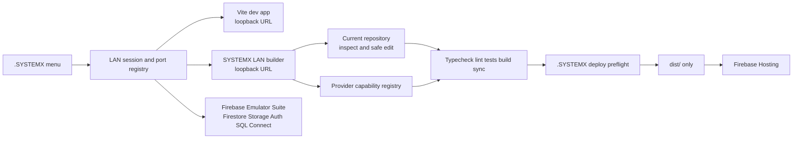

# SYSTEMX LAN Builder

## F003/F004 identity and ownership — final verification pending

Accepted progress remains **200/10,000 requirements and 40/2,000 capabilities**.
The next 200 select F003 (LAN-00201–LAN-00300) and dependent F004
(LAN-00301–LAN-00400); target **400 / 80** follows terminal checks and separate
Agent 0 family acceptance. The source-import inspector and protected API are
implemented with durable qualified references, reviewed reconciliation,
revision-bound ownership, local-integrity metadata export/reopen and separate
controlled-editor promotion. Read [Identity and Ownership](SYSTEMX-LAN-Identity-and-Ownership.md)
and the [active iteration](https://github.com/WayneTechLab/WebAppX/blob/main/docs/LAN-ACTIVE-ITERATION.md).

Ten authenticated CLI workers completed in separate branches/worktrees; Agent 0
reviewed scoped commits and merged them locally. Exact-candidate CI/browser,
GitHub delivery and acceptance remain pending here. This does not qualify live
swarm PR approval/automatic merge, native IDE/Windows or production.


## Responsive workspace and planned editor fork

Sidebar tracks, tabs, component metadata and native forms now flex within the
available width. Decorative symbols retain accessible labels. Compact screens
focus one sidebar while keeping pin preferences; device/footer controls wrap.
The new browser layout gate covers desktop through mobile controls before final
qualification. The user-requested [Code-OSS fork plan](https://github.com/WayneTechLab/WebAppX/blob/main/docs/LAN-VSCODE-FORK-PLAN.md)
and [32-item additive backlog](https://github.com/WayneTechLab/WebAppX/blob/main/docs/backlog/LAN-VSCODE-FORK-TODO.md)
are proposed, with zero accepted items. They do not replace the two fixed catalogs
or imply a custom editor has been built.

The SYSTEMX LAN Builder is the local management surface for the WTL WebApp Stack G1
template. It reuses the strongest general ideas from the public
[WTL-Instatic](https://github.com/WayneTechLab/WTL-Instatic) reference—visual
modules, reusable components, templates, collections, design tokens, media,
permissions, audit evidence, and publish separation—while keeping this
template's Firebase, Vite, Node, and `.SYSTEMX` operating rules.

## LAN expansion program and guarded source revisions

The [execution plan](https://github.com/WayneTechLab/WebAppX/blob/main/docs/LAN-10000-EXECUTION-PLAN.md)
and [checklist index](https://github.com/WayneTechLab/WebAppX/blob/main/docs/backlog/LAN-10000-TODO.md)
contain 100 proposed families, 2,000 capabilities and 10,000 delivery requirements.
Completion is reviewed against exact definitions, source revisions, dependencies
and dated proof; a roadmap row or readiness query activates no provider.

Source reads now return a byte revision. Saves require that loaded revision;
a stale source change returns409 without backup/write/log effects. Drafts stay
intact, and **Reload latest source** is explicit. Raw and leaf editors keep
independent bases; conflict and transport guidance differ, and CRLF-preserving
no-op behavior accounts for textarea normalization. Read the
[API reference](SYSTEMX-LAN-API-Reference.md) and
[source QA receipt](https://github.com/WayneTechLab/WebAppX/blob/main/docs/LAN-SOURCE-REVISION-QA-2026-10-26.md).

**Historical F002 acceptance: 200/10,000 requirements and 40/2,000 capabilities.**
F001 and F002 are complete; 9,800 requirements remain TODO. Exactly
LAN-00101–LAN-00200 are newly accepted at `e1588c4ebe94b1ef5f1557641334d95aee9b8290`; the previous 100 records
remain unchanged. The source browser adds eligible metadata/filtering, canonical
path rules, size/encoding/generated-source decisions, read-only policy review,
optional revalidated navigation and explicit metadata-only export.

Read the [source-policy guide](https://github.com/WayneTechLab/WebAppX/blob/main/docs/LAN-SOURCE-POLICY.md)
and [final QA receipt](https://github.com/WayneTechLab/WebAppX/blob/main/docs/LAN-SOURCE-POLICY-QA-2026-10-30.md).
Terminal qualification: 70 CI stages, 114 core tests, 32 local swarm tests, 20 new
browser groups, 55 source regressions plus seven geometry checks, 16 Navigator
groups and separate Hosting preflight. The [swarm](SYSTEMX-Swarm.md) remains a
separate host feature; no live AI-provider/GitHub merge or production activation
is inferred.

The prior [conflict-review milestone](https://github.com/WayneTechLab/WebAppX/blob/main/docs/LAN-CONFLICT-REVIEW-QA-2026-10-26.md) added source comparison,
missing-file draft protection and explicitly reviewed replacement. The
[previous F001 receipt](https://github.com/WayneTechLab/WebAppX/blob/main/docs/LAN-RECOVERY-HISTORY-QA-2026-10-29.md) completed source-family acceptance with draft recovery, comparison export and revision history.

Use **Build → Code → Compare latest** to inspect the retained proposal beside
the latest source and changed line excerpts. Comparison leaves the draft and its
loaded revision intact. **Review replacement** prepares that exact proposal;
type `SAVE LOCAL CHANGE` again and choose **Save reviewed replacement** to submit
against the reviewed revision. A newer external edit still conflicts.

Cancel the comparison to discard its review authority while keeping the draft.
Editing the draft, switching files or requesting a load invalidates the review.
When the source is unavailable, the editor keeps the draft and loaded revision
and blocks saving; restore the file externally or select an existing file and
reload. It offers no recreation or force-save action.


**Previous F001 milestone: 100 requirements / 20 capabilities; 9,900 requirements remained
TODO at that revision.** The recovery/export/history batch adds fifteen exact completions and
finishes F001's 100 requirements. Fonts and source-bound previews retain their
earlier acceptance; they are regression-tested without being counted again.

Candidate `04813b3` passed all 68 CI stages, 72 npm tests, 55 source-flow browser
groups, seven inspector geometry checks, 16 actual-stack Navigator groups and separate
Hosting preflight. The initial missing-helper fixture failure and browser
startup-readiness failure remain separate from the terminal reruns.
Production deployment was skipped.

The actual WebAppX Home was changed through LAN's Code and visual-text GUI, with
three exact predecessor backups and rendered readback. Its new portal link
opens account-free HR, CMS and CRM. The current receipt and GUI walkthrough
separate plan, code, function, local working, GitHub delivery and production.

The previous font/preview milestone pinned re2js 2.8.7; this batch changes no
dependency versions or audit thresholds. Historical audit observations retain
their original scope. Read the new QA receipt for this candidate's validation.

Read the [previous F001 QA receipt](https://github.com/WayneTechLab/WebAppX/blob/main/docs/LAN-RECOVERY-HISTORY-QA-2026-10-29.md) and
[LAN GUI walkthrough](https://github.com/WayneTechLab/WebAppX/blob/main/docs/LAN-TEMPLATE-GUI-WORKFLOW.md).

## Font revisions and source draft previews

In **Design → Style**, the Font browser shows the observed raw revision of
`src/index.css`. **Refresh font source** reads it again without replacing an open
Code draft. A `SAVE FONT CHANGE` save submits that observed baseline; source that
changed since the observation is refused until it is reviewed and refreshed.
Success exposes the new revision and preserves the exact predecessor backup.
An open raw CSS draft keeps its own baseline and receives the usual stale-save
refusal if the font operation advanced its source.

In **Build → Code**, load an allowlisted source file, edit its draft and choose
**Preview draft**. This captures literal source text, its displayed-text digest,
loaded source revision, path and current source observation. **Check source**
performs a source GET and reports matching, changed, unavailable or unknown state;
**Close preview** discards the snapshot and preserves the editor. A later editor
change is identified separately from that immutable snapshot. The excerpt is
bounded and omission is explicit. The preview neither executes markup/JSX nor
compiles an alternate application, saves source or creates replacement authority.

The [font/preview QA receipt](https://github.com/WayneTechLab/WebAppX/blob/main/docs/LAN-FONT-PREVIEW-QA-2026-10-28.md)
records the candidate and actual verification status. The [active plan](https://github.com/WayneTechLab/WebAppX/blob/main/docs/LAN-ACTIVE-ITERATION.md)
keeps pending work separate from accepted counts. The LAN **Ops → Agent 0 → Work
sources** board reports the original WebAppX catalog and reusable/adopted records;
this separate LAN program's acceptance lives in its generated plan and checklist.

## Recovery, comparison downloads and source history

In **Build → Code**, opt in to one browser-local recovery slot for this checkout,
then choose **Store recovery draft** explicitly. Typing never stores it. After
refresh, **Review saved draft** checks current source before **Restore saved
draft** offers a deliberate editor replacement. The original raw baseline and
revision remain; a stale restored draft still receives the normal stale-save
refusal. Discard or opt out removes the slot while retaining the open editor.

Choose **Compare latest → Review export scope**, read the included source-text
scope, enter `EXPORT COMPARISON`, then choose **Download comparison JSON**.
The bounded download contains the path, revisions, complete proposed/current
text and honest comparison truncation metadata. It grants no source-save or
replacement authority. Edits or newer observations invalidate inclusion consent.

**Refresh history** reads selected operation metadata and current source. Rows
distinguish recorded checkout-bound saves, qualified legacy operations and
unattributed session observations. Missing hashes are not invented. The view
does not restore backups or write source. Source/font responses carry an opaque
checkout identity, which protects recovery against another checkout using the
same browser address; it is not a credential or a Git commit identity.

The actual Home was updated through Code and visual text controls, with three
exact predecessor backups. Its new **Explore demo portals** link opens the
account-free HR/CMS/CRM directory. The live recovery/restore, confirmed 9,039-byte
comparison download and history readback preserved source, backups and logs.
Read the [GUI walkthrough](https://github.com/WayneTechLab/WebAppX/blob/main/docs/LAN-TEMPLATE-GUI-WORKFLOW.md)
and [QA receipt](https://github.com/WayneTechLab/WebAppX/blob/main/docs/LAN-RECOVERY-HISTORY-QA-2026-10-29.md)
for the plan/code/function/local/production delta and exact bounds.

## What it is for

The first target is the **current checkout**. A staff member or builder should
be able to open the local LAN dashboard, inspect the existing template, edit a
page or shared component, preview the result in Vite and Firebase emulators,
review a backup/diff, run quality gates, and decide whether to deploy.

It is not a new public route and it does not replace the normal React app. LAN
source stays under `.SYSTEMX/LAN`; the product's required Vite/Firebase files
stay at the repository root; production Hosting continues to publish `dist/`
only.

Local URLs:

```text
http://127.0.0.1:<app-port>/             # public Vite app
http://127.0.0.1:<app-port>/__systemx/   # LAN dashboard through Vite dev proxy
http://127.0.0.1:<lan-port>/             # LAN dashboard direct loopback service
```

The `/__systemx/` bridge is Vite development only. Firebase Hosting still
deploys the public `dist/` output and does not publish LAN files.

For the operator sequence, dynamic-port rules, start/end-of-day checklist,
editor controls, evidence policy, and stop conditions, read the [SYSTEMX LAN
Operations Manual](SYSTEMX-LAN-Operations-Manual.md). For the exact local read
and mutation contract, read the [SYSTEMX LAN API
Reference](SYSTEMX-LAN-API-Reference.md).

The public WebApp's `/login` and `/admin` routes are part of the same local
operator flow. Start `npm run dev:systemx` to own Vite, LAN, and the Firebase
Auth/Firestore/Storage emulators together; the supervisor auto-selects free
ports so another project's local session is not reused. The full identity and
claim boundary is documented in
[Unified Login and Admin Operations](Unified-Login-and-Admin-Operations.md).

Current status: the functional G1 local-edit vertical slice is active. The
dashboard imports the current checkout's pages, routes, components, token
sources, KIT files, and provider capabilities. It can manage local page
metadata, typed node-tree fixtures, CMS/CRM records, local user fixtures, and
allowlisted React/Vite source files. Source writes are protected by a session
token, backup, secret scan, and explicit `SAVE LOCAL CHANGE` confirmation.
Cloud writes are not enabled by a readiness card; they require a future
authenticated adapter and the existing `.SYSTEMX` preflight.

## Live Navigator — 2026-10-25

Open the Vite-origin `/__systemx/` bridge and select **Navigator** (shortcut `Z`).
Search tags, IDs, classes, `data-systemx-name` or `data-systemx-component`; labels
use bounded structural metadata. Click a row to inspect it, use branch chevrons
to expand/collapse, and use the clickable canvas breadcrumbs to select an ancestor.
**Reveal selection** clears a hiding query, opens the ancestor path and scrolls
a visible target into view. Hidden, inert or unrendered elements remain unavailable
on the canvas and are not made visible by inspection.

Inside the tree, Up/Down move through visible rows, Right expands or enters a
branch, Left collapses or moves to its parent, Home/End reach the visible ends,
and Enter/Space select. Keyboard focus stays in the Navigator. Typing in search
does not run canvas navigation shortcuts. Route changes, removed nodes and replaced
iframe documents cannot activate stale targets; reload may clear selection.

The snapshot is bounded to 1,500 nodes, depth 40, 500-character metadata fields,
a 160-character query, 120 matches and 500 projected rows. Incomplete results
show a truncation notice. It covers the current rendered DOM, excluding unmounted
routes, shadow roots and cross-origin frame contents. The existing guarded leaf
text editor remains separate; this tree adds no source-write or reorder operation.

Read the [25-source official Webflow study](https://github.com/WayneTechLab/WebAppX/blob/main/.SYSTEMX/LAN/WEBFLOW-RESEARCH-2026-10-25.md),
[local usage guide](https://github.com/WayneTechLab/WebAppX/blob/main/.SYSTEMX/LAN/README.md)
and [dated Navigator QA receipt](https://github.com/WayneTechLab/WebAppX/blob/main/docs/LAN-NAVIGATOR-QA-2026-10-25.md).
The study retains the familiar structure/canvas/inspector layout, corrects stale
competitor assumptions and sequences later canonical document, command journal,
style, component/CMS and release work. Those later capabilities remain planned.

Final local validation on `dcca2b7300464a4df9a41460959ab907b9c58968` passed all 68 CI stages,
16 live Navigator groups, 19 npm tests and Hosting preflight. Dependency audits
for root, starter and Gusto backend reported zero vulnerabilities. Production
deployment was skipped; the app remains 3.4.0 with deployment count 0.

## LAN Builder Designer research overlay

The supplied `SFWA-WTL-LAN-BUILDER-DESIGNER-RESEARCH-PACKAGE-v1.0.0` package is now
preserved and mapped into `.SYSTEMX/LAN/Research/LAN-Builder/`. It contributes a
clean-room study of 200 public/documented sources, a 13-wave implementation
roadmap, 91 feature rows, 106 backlog tasks, 27 risks, 91 acceptance criteria,
and draft contracts for the future Designer kernel.

This does not change the current capability claim. The G1 LAN vertical slice
is implemented and testable today; the full LAN Builder Designer remains future
work beyond the completed Wave 0 integration and is not complete until every
wave gate passes. See the dedicated
[SYSTEMX LAN Builder Designer Master Plan](SYSTEMX-LAN-Builder-Designer-Master-Plan.md), the
[implementation overlay](https://github.com/WayneTechLab/WebAppX/blob/main/.SYSTEMX/LAN/LAN-BUILDER-DESIGNER-MASTER-PLAN.md),
and the [current status board](https://github.com/WayneTechLab/WebAppX/blob/main/.SYSTEMX/status/LAN-BUILDER-DESIGNER-MASTERPLAN.md).

The integrated Wave 0 checks are complete and remain available with `npm test`.
They start a
separate test LAN port, verify local health/read models, require the session
token for mutations, reject source paths outside the allowlist, and verify
runtime folders and arbitrary API commands are not exposed. The test server
uses an explicit test-only mode and does not overwrite the operator's active
session record.

The machine-readable
[`capability-manifest.json`](https://github.com/WayneTechLab/WebAppX/blob/main/.SYSTEMX/LAN/Builder/contracts/capability-manifest.json)
separates supported, guarded, and planned behavior. It is intentionally more
conservative than the visual surface: a button or panel does not make a future
Designer capability supported.

## Current designer layout

The LAN builder uses a canvas-first, four-sided editor layout:

- top toolbar for Design, CMS, Insights, SYSTEMX, command search, and session
  status;
- left rail and left dock for structure tools such as Add, Pages, Navigator,
  Components, Assets, CMS, Cloud, and Audit;
- center canvas for the running Vite preview;
- resizable left and right panel dividers with keyboard support;
- right tool rail grouped as Design, Data, Build, and Ops;
- tabbed right inspector for Style/Settings, CMS/Users, Code/Cloud, and
  Agent 0/MCP/Gates;
- right inspector open by default in a fresh layout so element controls are
  immediately available, with an independent collapse control;
- `Layers` canvas dock for layer tree and page-model tools, closed by default;
- fixed bottom application bar with centered responsive-device controls,
  Inspect/Interact mode, stack-location feedback, and an on-demand Evidence
  drawer.

Clicking Style or another right tool opens only that inspector. Clicking
canvas chrome outside the preview returns the workspace to `#canvas` and
collapses the right inspector; clicking an element inside the live preview
retains or opens its Settings context. Opening the right inspector closes the
bottom layer dock so the operator does not fight multiple side menus at once.
The left and right rails are icon-first and expose their labels through
tooltips, which keeps the canvas wide while preserving discoverability. The
canvas page picker sits above the preview and the bottom bar owns breakpoint,
device, pixel-width, Fit, Inspect, and Evidence controls. Panel widths and
active tabs persist locally; a layout schema migration prevents an older
saved arrangement from restoring the crowded pre-refinement widths. At
smaller desktop widths, opening one heavy panel closes the other side to
protect the canvas. At phone widths, the selected panel replaces the canvas
until the operator returns; it never overlays the editor plane.

### Dock visibility state

The close chevron and the visibility policy are intentionally separate. Each
side has a compact **Keep open** button and an adjacent status badge:

- **Auto** is the default. SYSTEMX may close an unpinned side during a save,
  refresh, resize, or opposite-side switch when the preview needs the width.
- **Always shown** is an explicit operator confirmation. A pinned side is not
  auto-closed by editor refreshes or canvas-width protection.
- The chevron is still a manual close action. Manually closing a pinned side
  clears its pin and returns it to Auto, so the visible status and local layout
  state cannot disagree.

Before every layout save, the builder reconciles the actual dock classes,
collapsed state, and pin state. This save-loop check prevents an asynchronous
page-model/source save or refresh from restoring a stale menu state.

The compact keyboard map follows the editor pattern: `A` Add, `P` Pages,
`Z` Navigator, `Shift+A` Components, `J` Assets, `⌘K`/`Ctrl+K` Quick Find, and
the arrow keys move through the selected preview hierarchy when Inspect is
active (Up parent, Down child, Left/Right sibling).

## Font browser, loaded-font inventory, and project typography

The Style inspector now contains the **Font browser**, which is the template's
controlled typography entry point. It has three distinct lanes:

1. **Catalog:** a checked-in offline catalog at
   `.SYSTEMX/LAN/Builder/contracts/font-catalog.json` provides a safe baseline.
2. **Live metadata:** if the local operator sets
   `SYSTEMX_GOOGLE_FONTS_API_KEY` for the LAN process, for example with
   `export SYSTEMX_GOOGLE_FONTS_API_KEY=...` before
   `npm run dev:systemx`, the server may query the Google Fonts Developer API.
   The browser receives family metadata only; the API key never crosses the
   LAN response or enters a log. Without the key, the checked-in catalog is
   used.
3. **Preview and source:** selecting a family requests only the chosen Google
   Fonts CSS2 weights in the running Vite iframe. The panel also reports the
   iframe's loaded `document.fonts` faces and current project source state.

Previewing a font never changes the repository. A project change requires the
exact confirmation `SAVE FONT CHANGE`. SYSTEMX then creates a local backup,
updates the controlled `src/index.css` Google CSS2 import and
`--wtl-font-family` token, promotes the file atomically, and records the
family, CSS URL, line counts, and backup path in the local operation log.
The project retains a system-font fallback for offline work and the LAN
dashboard is never copied into `dist`.

Google documents the CSS2 request format, variable-axis syntax, `display=swap`,
and targeted weight requests in the [CSS2 API guide](https://developers.google.com/fonts/docs/css2).
The family metadata contract and optional API key behavior are described in
the [Google Fonts Developer API guide](https://developers.google.com/fonts/docs/developer_api).

## Select the running app like an editor

Open LAN through the Vite bridge and leave **Inspect** enabled:

1. Hover any rendered item to see its boundary.
2. Click it to select it. The workspace reports its app route, mapped source
   file, and DOM path.
3. Right-click it to select a parent, open the Navigator, open mapped source,
   or stage the element as a module/component.
4. Use the Up Arrow to walk to the parent element.
5. Review the staged module in Components and type `SAVE MODULE` only when its
   name, source, tags, slots, and width contract are correct.
6. Turn Inspect off when testing links, forms, menus, or other normal app
   interactions.

For a heading, paragraph, label, or other safe leaf-text element, the click
also opens **Settings → Selected text**:

1. Edit the field and choose **Preview text** for an iframe-only change.
2. Choose **Revert preview** to restore the captured text without touching
   source.
3. Choose **Open source** to inspect the mapped React/TypeScript file.
4. Type `SAVE TEXT CHANGE` and choose **Save text to source** only after review.
5. SYSTEMX saves only when the original text appears exactly once in the
   allowlisted source. The normal secret scan, backup, atomic write, Vite hot
   reload, and quality-next handoff remain mandatory.

The Navigator hierarchy and Components selected-target card update from the
same preview selection. Nested elements, ambiguous source matches, and
unmapped content are intentionally routed to the source editor rather than
being rewritten automatically.

Header, footer, page-snap menu, help desk, and accessibility controls expose
`data-systemx-source` hints. Page sections map through the current route
registry. Inspection is intentionally unavailable from the direct LAN origin;
use `http://127.0.0.1:<vite-port>/__systemx/#canvas` so the preview and editor
share an origin. These hints exist only in Vite development, and the build
fails if any hint or LAN marker enters production `dist`.

The layout contract and 56-record de-identified research register are maintained in:

- [SYSTEMX LAN Designer Contract](https://github.com/WayneTechLab/WebAppX/blob/main/.SYSTEMX/LAN/LAN-BUILDER-DESIGNER.md)
- [LAN Builder UX Research](https://github.com/WayneTechLab/WebAppX/blob/main/.SYSTEMX/LAN/LAN-BUILDER-UX-RESEARCH.md)

## Local topology



The start-of-day command discovers safe unused ports and records the owning
processes. The end-of-day command closes only those recorded processes and
verifies that the ports are free. It must never stop an unrelated local
project just because that project uses a familiar development port.

Port selection checks both `127.0.0.1` and `::1`, so a project listening on
either loopback family reserves that port. The active session is recorded in
ignored `.SYSTEMX/state/local-session.json`; stale PID files are removed only
when their process no longer exists. Use:

```text
npm run dev:systemx
npm run systemx:session:status
npm run systemx:session:stop
```

## Storage choices

The builder intentionally keeps storage products separate:

| Need | Service | Rule |
| --- | --- | --- |
| Draft pages, tokens, builder metadata | Firestore | Document-oriented data and live draft state |
| Optional presence or transient coordination | Realtime Database | Ephemeral state, not the audit record |
| CRM, reporting, relational transactions | Firebase SQL Connect + Cloud SQL for PostgreSQL | Explicit relational module with typed GraphQL operations |
| Web images, video, and uploads | Cloud Storage for Firebase | Firebase Rules and signed URL policy |
| Staff documents, setup packets, brand kits | Google Drive/Shared Drive | Operator document workflow, not public runtime data |
| Internal archives | Google Cloud Storage | Approved server/CLI archive path |

Firebase SQL Connect is the Firebase SQL-backed option. It connects to
PostgreSQL in Cloud SQL and uses schema/query/mutation definitions with a local
emulator path. Firestore and Realtime Database remain separate non-relational
Firebase products.

Useful references:

- [Firebase SQL Connect quickstart](https://firebase.google.com/docs/sql-connect/quickstart)
- [SQL Connect configuration reference](https://firebase.google.com/docs/sql-connect/configuration-reference)
- [Cloud Storage for Firebase](https://firebase.google.com/docs/storage)
- [Google Drive files and folders](https://developers.google.com/workspace/drive/api/guides/about-files)

## Builder objects

The visual editor is backed by typed data, not raw HTML pasted into a page:

- pages and layouts use a `NodeTree` of containers, text, images, links,
  buttons, lists, forms, slots, and outlets;
- reusable components have typed parameters and named slots;
- collections have a schema, provider, query contract, and access policy;
- loops bind a page module to an approved collection query;
- design tokens control color, type, spacing, responsive breakpoints, and
  sanitized CSS values;
- the centered bottom application bar provides desktop/laptop, Apple
  iOS/iPadOS, Android, exact-width, and Fit preview modes that resize the real
  local iframe;
- assets track provider, usage, content type, size, and sync state;
- every mutation has a backup, diff, validation result, and audit event.

The builder is allowed to provide detailed CSS controls, but values still pass
the template's sanitization and production-build checks. “Full CSS control”
does not mean arbitrary script or unsafe HTML injection.

## Logs and evidence

The LAN builder records local evidence without making it public:

- `.SYSTEMX/LAN/Temp/operations.jsonl` for local operation events;
- `.SYSTEMX/LAN/Backup/<timestamp>/` for pre-write snapshots;
- `.SYSTEMX/LAN/Files/component-registry.json` for reusable component records;
- `.SYSTEMX/LAN/Files/local-data.json` for local page, CMS/CRM, and user
  fixtures;
- `.SYSTEMX/LAN/Temp/ingest/<run-id>/manifest.json` for inventory-only
  existing-project scans.

Read the public log map in [SYSTEMX Logs and Evidence](SYSTEMX-Logs-and-Evidence.md).

## Staff workflow

1. Start the local SYSTEMX session from the menu.
2. Confirm the displayed Vite, LAN, and emulator URLs and active Firebase
   project mode.
3. Open the current-template workspace.
4. Inspect the route/page/component/token or data surface.
5. Make one bounded change.
6. Review the generated diff and backup record.
7. Confirm the write.
8. Preview in Vite and run the relevant emulator flow.
9. Run quality, security, structure, and sync checks.
10. Stop, hand off, or use the existing deploy preflight. Production deploy is
    never an implicit result of a local builder save.

## Implementation waves

The detailed plan and acceptance gates live in the main repository at
[`.SYSTEMX/LAN/BUILDER-SYSTEM-PLAN.md`](https://github.com/WayneTechLab/WebAppX/blob/main/.SYSTEMX/LAN/BUILDER-SYSTEM-PLAN.md).
The short sequence is:

1. contracts and current-repository inventory;
2. loopback LAN shell and safe session ports;
3. current-template workspace and Vite/emulator health;
4. guarded backed-up page/node/source edits;
5. Firestore/Storage/Auth emulator workflows;
6. optional SQL Connect/Cloud SQL module;
7. scoped Drive/GCloud document and asset sync;
8. staff roles, audit timeline, publish preflight, and rollback evidence.

The builder remains subordinate to the `.SYSTEMX` CLI. Its API must be an
allowlisted action registry, never a generic shell, database, or cloud proxy.

The current-template workspace contract is available through the local-only
`/api/builder/workspace` endpoint and is backed by
`.SYSTEMX/LAN/Builder/contracts/builder-workspace.schema.json`. The local
editor uses `/api/builder/data`, `/api/builder/source`, `/api/builder/page`,
and `/api/builder/record`; mutating requests require the session header. The
provider selection is capability-based: Firestore and Realtime Database are
document or presence lanes; Firebase SQL Connect/Cloud SQL PostgreSQL is the
relational lane; Cloud Storage for Firebase is the web-media lane; Drive and
Google Cloud Storage are operator-document/archive lanes.

## What “full builder” means in G1

This is a management surface for the existing app, not a replacement website
generator. The operator can select a route, review the source file, change its
metadata, stage typed modules such as containers/text/forms/lists, create local
CMS/CRM records, add local role fixtures, load an allowlisted source file, and
save only after a backup and explicit confirmation. Vite then provides the
live preview. This makes the current template editable now while preserving a
clear adapter boundary for the future source-to-node round trip.

The provider cards show the storage/data plan and local tool availability. They
are not production connections. Firestore/Storage/Auth emulator workflows,
Firebase SQL Connect/Cloud SQL schema operations, Drive/GCS file sync, and
Stripe test/webhook operations are separate implementation waves with their
own credentials, scopes, evidence, and rollback rules.
