# SYSTEMX LAN Identity and Ownership

This guide describes the F003/F004 local source-import workflow selected for
the LAN builder. The authored [F003](https://github.com/WayneTechLab/WebAppX/blob/main/docs/backlog/lan-10000/F003.md) and
[F004](https://github.com/WayneTechLab/WebAppX/blob/main/docs/backlog/lan-10000/F004.md) checklists own the exact requirements; the
[bounded iteration plan](https://github.com/WayneTechLab/WebAppX/blob/main/docs/LAN-IDENTITY-OWNERSHIP-PLAN-2026-10-30.md) owns the
execution sequence. The accepted baseline remains **200/10,000 requirements and
40/2,000 capabilities** (F001 and F002). The target after separate Agent 0
acceptance of both families is **400/10,000 and 80/2,000**. These pages do not
record acceptance or qualify an untested integration.

The import is a narrow `schemaVersion: 1` source identity read model for
eligible static TSX, alongside the future full
[Designer document schema](https://github.com/WayneTechLab/WebAppX/blob/main/.SYSTEMX/LAN/Builder/contracts/designer-document.schema.json).
It does not make the canvas DOM, generated artifacts, JSX expressions or
component internals into editable source. The existing
[F002 source policy](https://github.com/WayneTechLab/WebAppX/blob/main/docs/LAN-SOURCE-POLICY.md) decides which source path can be read;
identity metadata cannot widen that policy. The existing
[GUI source workflow](https://github.com/WayneTechLab/WebAppX/blob/main/docs/LAN-TEMPLATE-GUI-WORKFLOW.md) remains the path for a
deliberate guarded source save.

## Dashboard layout and preview interaction — candidate changes

The current candidate repairs clipped component/menu content with shrinkable
sidebar tracks, bounded fields and wrapped metadata. Compact panel focus keeps
pin preferences while hidden panes leave keyboard focus order. The workspace
menu aligns to its header trigger's right edge and long menus remain scrollable.
Concise controls keep action constraints/status visible; Help/More info and
workspace-detail disclosures hold longer explanations without growing the
primary canvas header when selection changes.

Inspect selection and metadata refresh retain the chosen preview device/width.
Interact passes ordinary links and controls to the app and keeps the selected
device during SPA navigation. Explicit Reveal/route actions keep their intended
navigation behavior. Read the
[dashboard UX research and implementation review](https://github.com/WayneTechLab/WebAppX/blob/main/docs/LAN-DASHBOARD-UX-2026-10-31.md)
for observed causes, official Webflow/W3C sources and the separate proof gates.

The CI plan now registers **73 stages**: all previous 70 retain their order,
with identity unit/API, identity browser and responsive-layout browser added.
Final exact-candidate browser/CI/preflight, independent review, F003-before-F004
acceptance and push/readback remain pending. A registered stage or provisional
browser run is not a final pass. Current accepted totals remain **200 / 40**;
the selected target remains **400 / 80**.

The separate [tailored Code-OSS fork plan](https://github.com/WayneTechLab/WebAppX/blob/main/docs/LAN-VSCODE-FORK-PLAN.md)
and [32 unchecked fork TODOs](https://github.com/WayneTechLab/WebAppX/blob/main/docs/backlog/LAN-VSCODE-FORK-TODO.md)
are planned work. This dashboard increment creates no custom native editor,
extension registry, installation, update service or catalog acceptance.

## Use the inspector

Open **Build → Code → Source identities** in the local LAN
builder. Select a canonical eligible TSX path through the source picker. The
inspector is read-only until an explicit import preview has been reviewed and
accepted. A refresh reports accepted maps and current status; it does not import
a selected file or replace an open Code draft. A picker change or workspace
change invalidates pending selection responses and write authority. A failed
preview, read or accept keeps the last accepted map and safe draft intact.

1. Choose **Preview import**. Review the selected path, route, workspace-qualified
   document and page IDs, rule version, source revision, preserved/added/retired/
   ambiguous counts, warnings and orphans. The preview parses source as data; it
   never executes imported TSX. Import and ownership metadata do not write a
   source file, backup or operation log.
2. Resolve duplicate authored anchors, ambiguous siblings, changed identity
   evidence and stale source before acceptance. A source-file rename requires
   the exact previous path in **Rename from** and review of its evidence. Alias
   input is a deliberate retired-ID migration, with target and provenance in
   the selected document; loops and cross-document targets are refused.
3. Enter `ACCEPT IDENTITY MAP` and choose **Accept identity map** only for the
   displayed proposal digest. Acceptance re-reads the eligible source and
   checks its raw-byte revision and workspace. If either changed, preview again.
4. Select a node to inspect its qualified reference, parent, confidence, source
   span and field ownership. Inspect an ownership change proposal separately;
   enter `ACCEPT OWNERSHIP CHANGE` against its exact digest to accept a valid
   metadata claim. A claim cannot enable an unsupported adapter operation.
5. For a supported literal, review the operation preview and its affected owner.
   The proposal is a span and replacement only. If a stage control is available,
   Agent 0's integrated controller may place it into the existing Code editor
   only when its loaded source revision exactly matches. Review the actual
   diff and use the existing confirmed, revision-guarded save flow to write.
   Preview, stage and save are distinct actions.

The export and reopen controls are deliberate. **Export identity document**
downloads a bounded, versioned metadata object. **Reopen** requires a compatible
export from the same workspace and `REOPEN IDENTITY DOCUMENT`, then rechecks
path eligibility and current source revision. A failed reopen preserves accepted
maps. An export is not a backup of source content, an executable project, or
permission to import into another checkout. Source bodies, readable labels, credentials,
absolute roots, private runtime paths, DOM handles and session tokens are
excluded. An ownership diagnostics export likewise contains qualified IDs,
modes, reason codes, counts and bounded span metadata only.

## Durable identity and reconciliation

The workspace ID is an opaque 64-character digest for the selected real
workspace; it is not the local root path. The document and page IDs derive from
the declared source and workspace, so a label change or inventory order change
does not alter them. Every lookup must supply `{workspaceId, documentId, nodeId}`.
Matching text or a matching relative path in another document or workspace
cannot resolve that reference. A workspace switch clears transient references.

Static `data-systemx-id` is the authored node anchor when its value is unique
in the document and matches `[A-Za-z][A-Za-z0-9_-]{0,79}`. Unanchored nodes use
a bounded structural signature qualified by parent evidence. Compatible unique
matches can survive a sibling reorder. Repeated indistinguishable siblings
remain distinct **unresolved** candidates; source order, line number and offset
alone never establish durable identity. Changed tag or anchor evidence can mean
replacement: the old ID retires instead of silently following a nearby element.

The inspector distinguishes `explicit`, `heuristic`, `reviewed-migration` and
`unresolved` confidence. A live canvas DOM element is only a transient rendered
representation. Its object handle, coordinates and current presence cannot
authorize an import or save. A supported mapping may identify a corresponding
preview object; absence or ambiguity stays visible. Retired IDs and orphaned
references keep provenance for review and do not attach to replacements by
proximity. The current implemented rule is `identity-v1`; unknown versions are explicitly
refused and require a separately implemented, reviewed migration. No v2 upgrade
is silently inferred from a version string.

## Ownership and source authority

Each object reports a mode, mapping status, adapter, supported operations,
unsupported operations, source owner and reason codes. The installed
`tsx-static-v1` adapter supports an exact scalar literal text proposal only.
Style, structure and generated operations are unsupported in this iteration.
Its source offsets are UTF-16 start/end-exclusive positions with fingerprints
of the exact selected spans; the file revision is SHA-256 of raw bytes.

| Mode | Meaning and current write boundary |
| --- | --- |
| `source-owned` | Authored repository source stays authoritative. An exact, nonopaque, nonexternal literal may be proposed when its field, revision, fingerprint and owner all validate. |
| `document-owned` | A claim must identify a reviewed generated output boundary and provenance. This iteration has no generator operation, so the mode does not permit regeneration or direct source edits. |
| `hybrid-controlled` | Source and document fields need explicit, nonoverlapping authority. Mixed or overlapping claims disable the affected write while preserving both claims for review. |
| `unmapped` | No qualified source target is established. The preview can show an element, but visible text, class names or DOM position do not invent a source path or write permission. |

`mapped`, `partial`, `stale`, `unmapped` and `conflict` statuses describe coverage;
they are not success counts for the whole repository. A report names excluded
scope. The inspector separates component instance fields from definition-owned
structure. Shared layout, navigation and shell source affects multiple pages,
so the impact preview must identify its declared shared owner before a
proposal. Route-associated pages use the reviewed route and source inventory;
identical text on another route is not the same owner.

JSX expressions and opaque source regions retain inspectable source metadata
but remain read-only. Uppercase/imported external components do not expose their
internals to this adapter. A supported external property contract must be
declared separately; import does not infer one from rendered output. Conflicting
claims on an overlapping span or field remain visible and block writes. The
same rule applies when definition ownership or shared impact is unknown.

The literal operation requires the qualified node, accepted map, compatible
field ownership, adapter support, exact expected raw revision, current source
span fingerprint and one unambiguous compatible occurrence. It refuses stale
maps, unsupported operation kinds, opaque or external internals, ambiguous
repeated literals and overlapping ownership. A refusal retains the proposal
context and draft for an explicit reimport or review. After a confirmed source
promotion, affected mappings must be revalidated against the new revision;
unrelated source and mappings are not repaired automatically.

## Limits and trust boundary

The service accepts only F002-eligible selected source. It keeps at most **50
accepted documents**, **1,000 nodes per document** (also subject to the transport byte cap), **256 aliases** and
**120-character labels**. Source input is capped at **1 MB**; proposals and
exports at **400 KB**; diagnostics at **1,000 records**. Invalid graphs,
duplicate anchors, cycles, bad references and over-limit input fail with stable
contained error codes. API refusals must not echo a source body, absolute path
or credential. Imported source is parsed with the installed TypeScript compiler
and never evaluated.

Accepted identity and ownership metadata live in the local service memory;
they are not placed into blank reusable `.SYSTEMX` context, plan, task or memory
seeds. Export and same-workspace reopen are the deliberate portability path for
this narrow read model. Neither F003 nor F004 changes immutable managed release
snapshots, research package checksums, brand/production kits, Firebase data or
the installation/import boundary described in
[SYSTEMX integration](https://github.com/WayneTechLab/WebAppX/blob/main/docs/SYSTEMX-INTEGRATION.md).

## Export integrity and recovery

The first explicit identity export creates an owner-private local integrity key
in ignored `.SYSTEMX/state/source-identity/`. The export includes an integrity
tag, and excludes the key. Compatible documents move between browsers connected
to the same workspace/backend and can reopen after a service restart while that
private runtime key remains available. A modified document is refused. Keep the
runtime key private and outside Git; a different checkout or lost key requires a
new export. An export is metadata, so source content still belongs to Git or the
operator's separate source backup.

Reopen validates the current eligible TSX syntax, exact node/field spans,
qualified allocation and revision. It cannot redirect an already accepted ID or
alias through a different metadata file; use a reviewed reconciliation for an
identity change. A failed import preserves the accepted map. No key is created
by preview, inspection or a refused import. Source, predecessor backups and
operation logs remain unchanged by metadata operations; explicit export has the
private runtime-key effect described above.

Generated source can be imported as explicitly read-only metadata. Its inspector
and export advertise no supported source operation, and source-policy refusal
still blocks operation and ownership changes. A separately reviewed declaration
can describe a document-owned public generated output, including its generator
version and output revision; it does not install a generator or authorize output
reads/regeneration outside the active source policy.

When a source change retires a claimed node, the import preview displays every
proposed ownership retirement. Acceptance preserves qualified source provenance
and the prior claim digest as read-only history. Claims bound to an earlier span
remain unavailable after promotion until reviewed; reimport does not silently
repair that authority. Duplicate groups are all reported within the bounded
scope using opaque identity digests and exact occurrence counts.

## Verification and delivery gates

The [plan](https://github.com/WayneTechLab/WebAppX/blob/main/docs/LAN-IDENTITY-OWNERSHIP-PLAN-2026-10-30.md) lists the fixture, API,
rendered GUI, preservation and terminal gate evidence Agent 0 must collect for
each exact revision. This document describes the contract and operator steps;
the integrated implementation has development unit/API/GUI evidence, while
exact-candidate CI, independent review, acceptance and publication remain separate
gates. Ten authenticated CLI executions are observed separately from live PR
merges, native Windows/IDE qualification and production deployment. A successful local preview or HTTP response alone does
not accept F003/F004 or authorize a source write.

## API map

All identity GET and POST routes require the current LAN session authority and
retain the loopback Host/Origin guards. Use the served GUI to obtain that session;
never put session values into a reusable guide or export.

| Method and path | Purpose |
| --- | --- |
| `GET /api/identity/status` | One workspace's accepted document metadata. |
| `GET /api/identity/document?documentId=…` | Accepted map, ownership, current revision and stale/retirement state. |
| `POST /api/identity/preview` | Eligible TSX import/reimport, reviewed rename/alias preview. |
| `POST /api/identity/accept` | Exact held proposal digest and `ACCEPT IDENTITY MAP`. |
| `POST /api/identity/lookup` | Exact workspace/document/node lookup. |
| `POST /api/identity/inspect` | Qualified ownership and confidence inspection. |
| `POST /api/identity/ownership/preview` | Separate structured field-ownership proposal. |
| `POST /api/identity/ownership/accept` | Exact held proposal and `ACCEPT OWNERSHIP CHANGE`. |
| `POST /api/identity/operation` | Bounded literal patch proposal; no source save. |
| `POST /api/identity/export` | Explicit bounded metadata export with local integrity tag. |
| `POST /api/identity/reopen` | Same-workspace/backend valid export and `REOPEN IDENTITY DOCUMENT`. |

Preview returns `{proposal, ownership, workspaceId}`. Reopen validates the full
export's integrity before current source/AST evidence; it does not trust a
client-declared span or replacement proof alone. Known page routes and shared
route contexts are checked against the reviewed inventory. Unknown mappings
remain explicit and never invent source ownership from rendered text.

```mermaid
flowchart LR
  Source[Eligible TSX and raw revision] --> Parse[Static syntax adapter]
  Parse --> Preview[Identity reconciliation preview]
  Preview --> Accept[Explicit map acceptance]
  Accept --> Inspect[Qualified ownership inspector]
  Inspect --> Proposal[Literal proposal]
  Proposal --> Draft[Controlled editor draft]
  Draft --> Save[Diff and separate confirmed save]
  Save --> Reimport[Revalidate affected mappings]
  Accept --> Export[Metadata export]
  Export --> Reopen[Integrity and current-source verification]
  Reopen --> Inspect
```

[LAN Builder](SYSTEMX-LAN-Builder.md) · [API reference](SYSTEMX-LAN-API-Reference.md) · [Swarm](SYSTEMX-Swarm.md) · [Home](Home.md)
